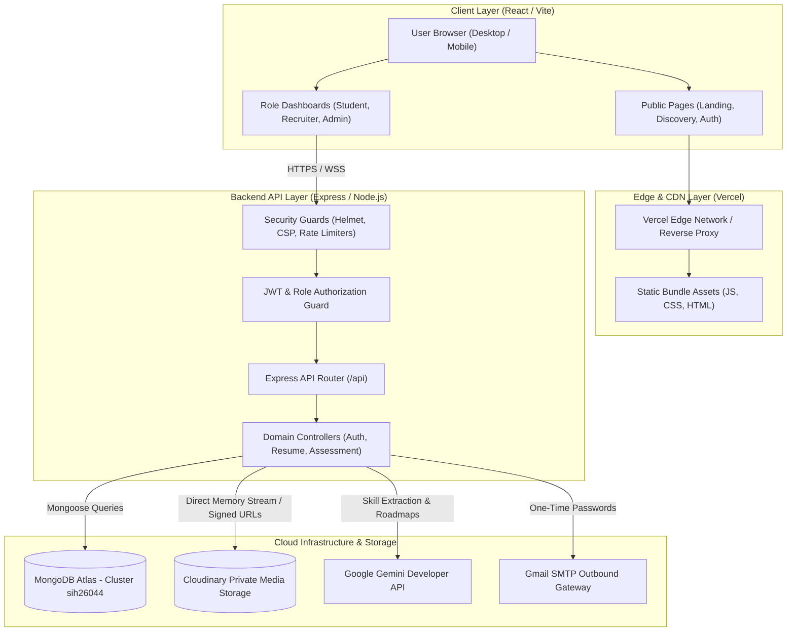
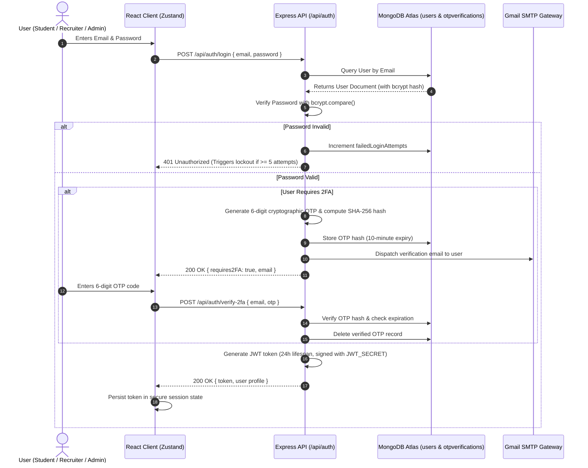
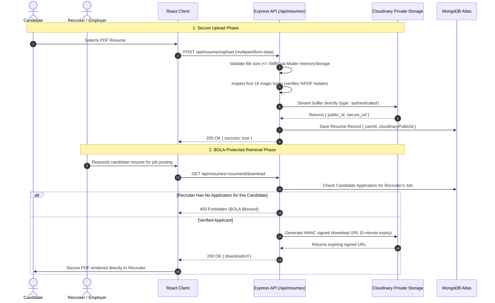
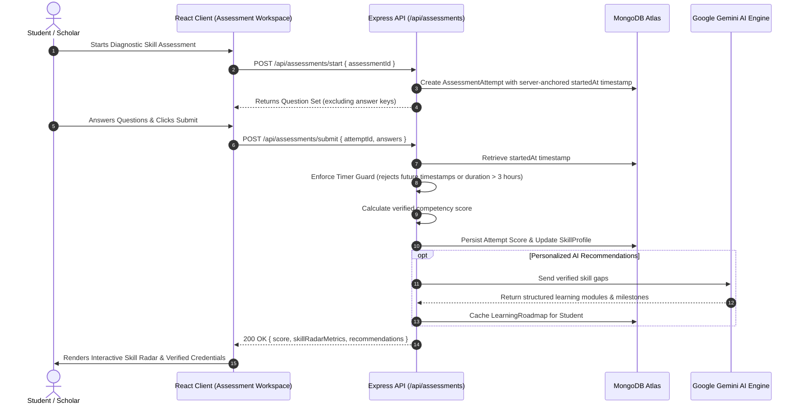

# System Architecture & Workflow Specifications: Nodal-Connector

---

## 1. High-Level System Topology

---

## 2. Authentication & Two-Factor OTP Security Flow

---

## 3. Resume Upload & BOLA-Protected Retrieval Flow

---

## 4. Assessment Engine & Competency Radar Flow

