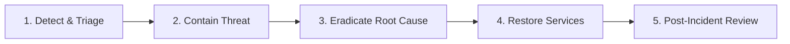

# Security Incident Response Playbook: Nodal-Connector

This runbook defines emergency procedures for responding to security incidents, credential leaks, and data breaches on the Nodal-Connector platform.

---

## 1. Incident Severity Classification

| Severity Level | Definition | Examples | Response Target |
| :--- | :--- | :--- | :--- |
| **P0 - Critical** | Active data breach, exposed database credentials, complete system outage | Publicly exposed `MONGODB_URI` in git, live ransomware, admin account takeover | Under 15 minutes |
| **P1 - High** | BOLA vulnerability exposed, unauthorized document access, credential stuffing | Unauthorized candidate resume downloads, targeted brute force attack | Under 1 hour |
| **P2 - Medium** | Non-sensitive API key exposure, transient rate limiting failure | Exposed read-only public key, elevated error rates | Under 4 hours |
| **P3 - Low** | Minor security header misconfiguration, informational dependency alert | Sub-optimal CSP warning, low-severity npm audit alert | Under 24 hours |

---

## 2. Emergency Response Procedures (Phase by Phase)



### Phase 1: Detection & Triage
1. **Confirm the alert:** Identify the vector (GitHub secret scanning alert, hosting crash logs, unusual spikes in MongoDB connections).
2. **Assign Incident Commander:** Designate lead engineer to execute recovery commands.
3. **Open an Incident Log:** Record all timestamps, actions taken, and affected user IDs in a private incident channel or secure offline log.

---

### Phase 2: Immediate Containment (Stop the Bleeding)

#### Scenario A: Secret Leak (Exposed Database URI or API Key)
Execute these actions immediately:
1. **Revoke Database Access:**
   - Log into MongoDB Atlas > **Security** > **Database Access**.
   - Immediately change the compromised database user's password or delete the user.
   - Any active connections using the leaked URI will be severed within seconds.
2. **Revoke Cloud API Keys:**
   - In Cloudinary, delete the compromised API Secret.
   - In Google AI Studio, delete the exposed Gemini API key.
   - In Google Account Security, revoke the Gmail App Password.
3. **Global Session Kill Switch:**
   If user tokens or the `JWT_SECRET` are compromised, update `JWT_SECRET` in your hosting dashboard or execute a global password timestamp bump in MongoDB:
   ```javascript
   // In mongosh: Invalidate all existing tokens issued prior to current moment
   db.users.updateMany({}, { $set: { passwordChangedAt: new Date() } });
   ```

#### Scenario B: Distributed Brute-Force / DoS Attack
1. In Vercel or your hosting CDN, enable **Attack Mode** / **DDoS Protection**.
2. Block offending IP ranges in Cloudflare or Vercel Firewall.
3. Verify that rate limiting is returning `HTTP 429 Too Many Requests`.

---

### Phase 3: Eradication (Fixing the Root Cause)

1. **Patch Vulnerability:**
   - Create a hotfix branch: `git checkout -b hotfix/security-patch`.
   - Implement the fix and verify with test suite:
     ```bash
     npm run test:verify --prefix server
     ```
2. **Purge Git History (If keys were pushed):**
   - NEVER simply make a new commit deleting the secret file. Old commits retain the secret.
   - Use the pristine repository from `../Nodal-Connector-clean` or use `git-filter-repo` to expunge the file from history.
3. **Provision Fresh Credentials:**
   - Follow [ROTATION_CHECKLIST.md](ROTATION_CHECKLIST.md) to generate fresh secrets for all affected systems.

---

### Phase 4: Recovery & Restoration

1. **Deploy Hotfix to Production:**
   - Update production environment variables with new credentials.
   - Redeploy frontend and backend instances.
2. **Database Integrity Check:**
   - Verify that no unauthorized admin accounts were inserted:
     ```javascript
     // In mongosh: Check recent admin creations
     db.users.find({ role: 'admin' }).sort({ createdAt: -1 });
     ```
   - If database records were corrupted, trigger a Point-in-Time Restore via MongoDB Atlas Backup to a moment immediately before the breach occurred.
3. **Run Smoke Tests:**
   - Test login, registration, OTP delivery, resume upload, and assessment completion.

---

### Phase 5: Post-Incident Review & Legal Notification

1. **Regulatory Reporting (India DPDP Act 2023):**
   - Under Section 8(6) of the Digital Personal Data Protection Act 2023, data fiduciaries must notify the Data Protection Board of India and affected data principals in the event of a personal data breach.
   - Prepare a formal incident report detailing:
     - Nature and extent of personal data involved.
     - Root cause of the incident.
     - Remedial actions taken to contain and prevent recurrence.
2. **User Communication Template:**
   ```
   Subject: Important Security Notice Regarding Your Nodal-Connector Account

   Dear [User Name],

   We are writing to inform you of a recent security incident that may have affected your account information. On [Date], our security monitoring detected [Brief description of incident].

   What We Did:
   We immediately contained the issue by revoking affected access keys, patching the underlying system, and invalidating existing login sessions.

   What You Need to Do:
   As an added precaution, please log into your account and reset your password. If you use the same password on other platforms, we strongly advise changing it there as well.

   For questions, please contact our security team at security@nodalconnector.in.
   ```
3. **Update Threat Model & CI Guardrails:**
   - Add automated test cases in `verifySuite.ts` to ensure regression protection.
