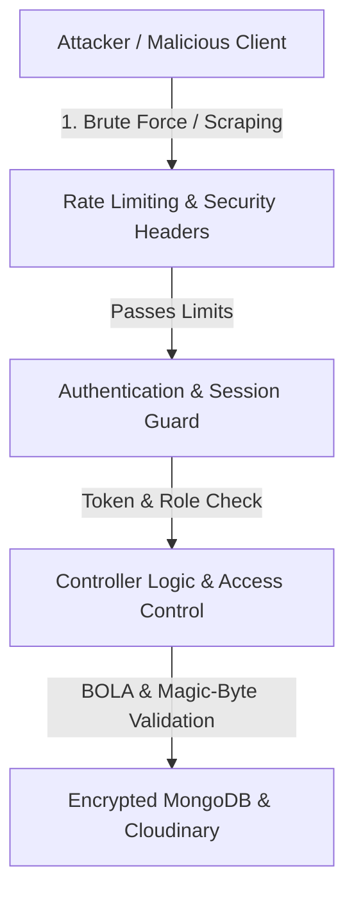

# System Threat Model: Nodal-Connector

---

## 1. Protected System Assets

| Asset Category | Description | Sensitivity Level | Business Impact of Compromise |
| :--- | :--- | :--- | :--- |
| **Authentication Tokens & Secrets** | JWT signing keys, password hashes, multi-factor OTP tokens | **Critical** | Complete account takeover, impersonation of platform administrators |
| **User Personal Data (PII)** | Student & candidate resumes, names, emails, academic performance | **High** | Privacy breach, legal liability under India DPDP Act 2023 |
| **Assessment Integrity Engine** | Test questions, grading algorithms, diagnostic skill benchmarks | **High** | Academic fraud, devalued employment certifications |
| **Institutional Verifications** | University claim requests, accreditation documents, admin approvals | **High** | Malicious entities posing as accredited universities |
| **Cloud Infrastructure Credentials** | MongoDB Atlas URIs, Cloudinary API secrets, Gemini AI API keys | **Critical** | Data exfiltration, cloud infrastructure ransom, financial loss |

---

## 2. Threat Actors & Attacker Profiles

1. **Anonymous Web Visitor / Botnet:** Crawlers seeking exposed `.env` files, open git folders, or unauthenticated API endpoints.
2. **Malicious Student / Candidate:** Authorized user attempting to bypass skill assessments, inspect answers, falsify completion times, or access peers' resumes.
3. **Disreputable Recruiter / Employer:** Actor attempting to mass-harvest student resumes without applying candidates (scraping talent databases).
4. **Insider / Compromised Staff Account:** Stolen administrative credentials attempting privilege escalation or database wiping.

---

## 3. Top 10 Abuse Scenarios & Implemented Mitigations

### 1. Broken Object-Level Authorization (BOLA) on Candidate Resumes [SEC-002]
- **Threat:** An employer changes `resumeId` in the URL to view resumes of candidates who never applied to their postings.
- **Implemented Control:** `resumeController.ts` strictly validates that the requesting recruiter has an active job posting for which the candidate submitted an application before generating a signed download link.

### 2. Credential Stuffing & Password Brute-Force [SEC-010]
- **Threat:** Automated botnets spray known compromised passwords against the `/api/auth/login` endpoint.
- **Implemented Control:** IP-based rate limiting (5 attempts per 15 minutes) combined with progressive account-level lockout: accounts freeze for 15 minutes after 5 consecutive failed attempts.

### 3. Assessment Clock Manipulation & Answer Spoofing [SEC-011]
- **Threat:** A student modifies JavaScript system time or freezes client timers to gain unlimited test duration.
- **Implemented Control:** Timers are strictly anchored on server-side timestamps upon test initiation. Submissions claiming completion times exceeding realistic durations (or with future timestamps) are rejected automatically.

### 4. Malicious File Upload & Remote Code Execution [SEC-005]
- **Threat:** An attacker uploads a PHP, executable, or SVG polyglot script disguised as a `.pdf` file.
- **Implemented Control:** Dual-layer defense: Multer checks file extensions and MIME types, followed by `validateUploadedBuffer()` which inspects the raw file magic bytes (verifying `%PDF`, `\xFF\xD8\xFF`, or `\x89PNG`). Ephemeral memory storage streams buffers directly to Cloudinary; zero files touch local disk.

### 5. CSV Formula Injection in Recruiter Candidate Exports [SEC-008]
- **Threat:** A candidate enters `=cmd|' /C calc'!A0` or `@SUM(...)` into their name or skills, triggering remote execution when an HR manager opens an Excel/CSV export.
- **Implemented Control:** `sanitizeCsvValue()` neutralizes all dangerous formula trigger characters (`=`, `+`, `-`, `@`, `\t`, `\r`) by prepending a safe apostrophe (`'`).

### 6. Cross-Site Scripting (XSS) & Content Injection
- **Threat:** Attackers inject malicious JavaScript into opportunity descriptions or portfolio project fields.
- **Implemented Control:** Strict Content Security Policy (CSP) blocking unauthorized external inline scripts; React automatic output escaping prevents DOM injection.

### 7. NoSQL Query Injection
- **Threat:** Supplying JSON operator payloads (such as `{"$gt": ""}`) in login queries to bypass authentication.
- **Implemented Control:** Strict type validation via Express schemas and Mongoose Object modeling, ensuring input fields are parsed as primitive strings rather than raw MongoDB query selectors.

### 8. Session Hijacking & Revocation Lag [SEC-004]
- **Threat:** An attacker steals an active JWT token from a user's browser.
- **Implemented Control:** Passwords track `passwordChangedAt` timestamps. Tokens issued prior to a password reset are instantly invalidated server-side upon every authenticated request.

### 9. OTP Interception & Replay Attacks
- **Threat:** Replaying an intercepted verification code to verify a fake email.
- **Implemented Control:** OTPs are stored exclusively as one-way SHA-256 hashes in MongoDB, expire strictly after 10 minutes, and are immediately deleted upon first successful verification.

### 10. Accidental Database Wipe [FIX-001]
- **Threat:** Running seed scripts in production wiping live student profiles.
- **Implemented Control:** `seedDatabase.ts` checks `NODE_ENV === 'production'` and halts immediately if executed in a production environment.

---

## 4. Residual Risk & Ongoing Monitoring

1. **Third-Party AI Outages:** If the Gemini API experiences downtime, skill extractions will fall back gracefully to empty recommendations rather than crashing.
2. **SMTP Port Filtering:** Cloud hosting platforms occasionally block outbound ports 587/465. Production deployment must verify outbound mail relay connectivity.
