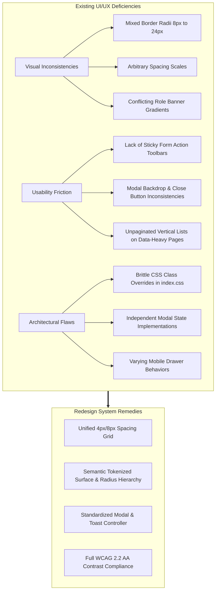
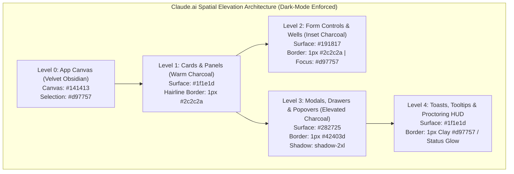
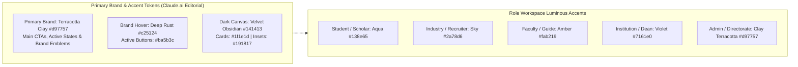
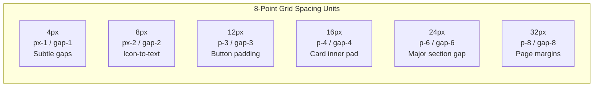
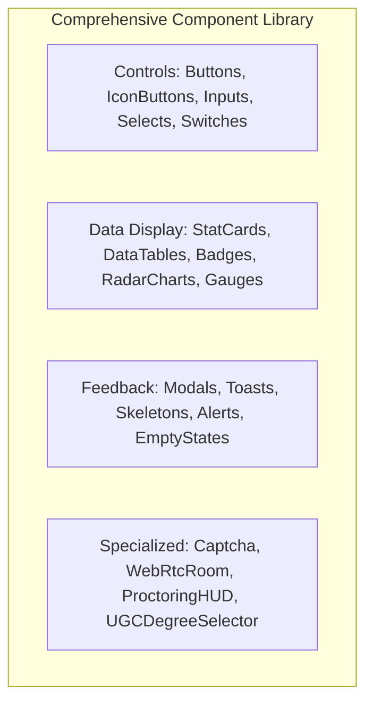
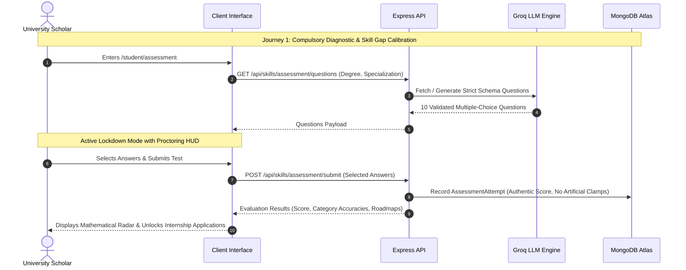
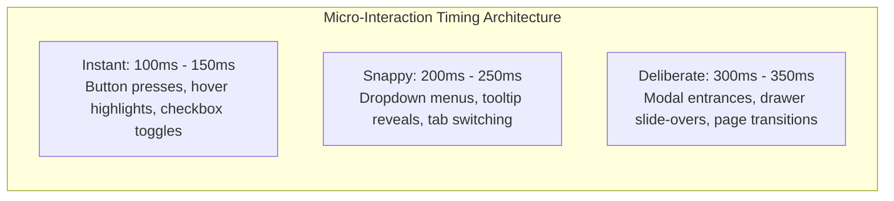
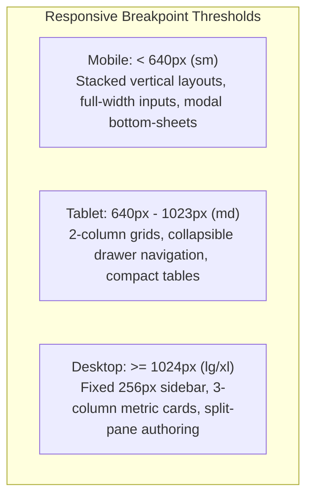
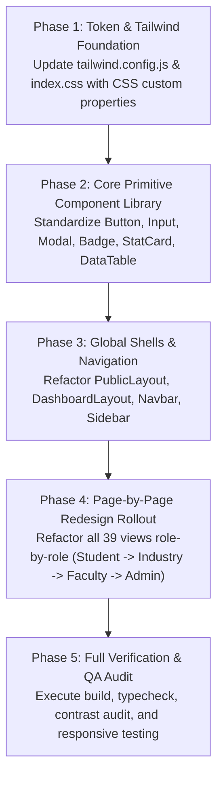

# NodalConnector — Definitive Frontend Redesign Specification & Design System
**Document Identifier:** `DESIGN-SPEC-SIH26044-V2`  
**Role:** Principal Design Director, Senior UI/UX Architect & Design Systems Specialist  
**Target Audience:** Frontend Engineering Team & Autonomous Coding Agents  
**Version:** 2.0.0 (Production Release Specification)  
**Status:** Implementation Ready — Definitive Handoff Blueprint  

---

## 1. Executive Summary

### 1.1 Design Vision & Mission
NodalConnector is the national digital platform engineered to bridge the systemic competency divide between Indian academia curricula (under the UGC Section 22 and NEP 2020 framework) and real-world corporate expectations across Engineering, Technology, Data Sciences, and Ayush Bio-Pharmaceutical disciplines.

This document serves as the **unconditional, definitive design specification** for transforming the entire frontend from an ad-hoc prototype into an authoritative, enterprise-grade, cohesive digital ecosystem. Every visual element, page layout, interaction state, responsive breakpoint, design token, and accessibility requirement is specified with mathematical precision so that implementation teams and coding agents do not have to guess or improvise design decisions.

### 1.2 Core Redesign Objectives
1. **Unified Claude.ai Editorial Aesthetic**: Elevate the portal to match the visual craftsmanship and tactile polish of modern AI-first interfaces (such as Claude.ai) featuring warm velvet obsidian canvas (`#141413`), warm charcoal card surfaces (`#1f1e1d`), input wells (`#191817`), hairline borders (`#2c2c2a`), and signature warm terracotta clay accents (`#d97757` / `#c25124`).
2. **Strict Dark-Mode-First Architecture (Dark Mode Enforced)**: The entire portal operates in a dedicated, high-contrast, eye-strain-free Dark Mode. All UI layers, components, modals, and charts render exclusively in the warm obsidian palette with zero light-mode flicker (FOUC-free synchronous root hydration).
3. **Role-Tailored Visual Hierarchies with Luminous Accents**: Establish distinct, purposeful workspace identities for all five system archetypes (Students/Job Seekers, Corporate Recruiters, Academic Faculty, Institutional Deans, and National Directorate Administrators) using luminous high-contrast accents (Aqua `#138e65`, Sky `#2a78d6`, Amber `#fab219`, Violet `#7161e0`, Terracotta `#d97757`) while preserving unified layout ergonomics.
4. **Information Architecture & Density Optimization**: Transform sprawling, vertical-scroll pages into dense, dashboard-first workspaces featuring progressive disclosure, sticky headers, structured filter toolbars, and contextual analytical sidebars.
5. **Absolute Functional & Data Integrity**: Preserve 100% of underlying business logic, real-time Socket.IO WebSockets, WebRTC P2P signaling, anti-bot CAPTCHA, AI-driven entity parsing, and honest zero-inflation scoring (0–100% strictly calculated without mock data or artificial floors).

---

## 2. Project Understanding & Domain Context

### 2.1 Problem Statement & Background (SIH26044)
- **Title**: *Portal for Academia – Industry Collaboration for Skill Mapping, Internships and Placement*
- **Sponsoring Body**: Ministry of Ayush & Higher Education Directorate
- **National Mandate**: National Education Policy (NEP 2020) & University Grants Commission (UGC) Section 22 framework.
- **Core Challenge**: Conventional university portals lack live industry feedback loops, resulting in graduates possessing theoretical degrees without operational competencies. NodalConnector solves this by providing:
  - Dynamic skill mapping and proctored diagnostic gap testing.
  - Transparent candidate-opportunity matchmaking with verified skill proofs.
  - Joint industry-curriculum alignment, faculty immersion, and verifiable digital MoUs.
  - Institutional cohort tracking and automated college web discovery.

### 2.2 User Personas & Archetypes

| Persona Archetype | User Role Key | Primary Goals & Workflow | Key Mental Models & UI Needs |
| :--- | :--- | :--- | :--- |
| **University Scholar** | `student` (`.edu.in`) | Take skill diagnostics, review resume extractions, evaluate target role gaps, discover stipendiary internships, and join WebRTC interviews. | Data-dense visual radar, clear progress milestones, gamified competency scores, transparent gap roadmaps. |
| **Open Career Seeker** | `jobseeker` (Any Email) | Validate skills independently, access career opportunities, build a verifiable portfolio, and submit job applications. | Frictionless entry, clear application state tracking, honest compatibility scores. |
| **Corporate Recruiter** | `industry` | Post internships/jobs, search pre-assessed candidates with verified scores, manage applicant pipelines, evaluate proposal synergy via AI, and conduct video interviews. | Fast keyboard navigation, split-pane applicant dossiers, bulk status transitions, reliable video calling. |
| **Academic Faculty** | `academician` | Monitor institutional scholars, publish workshops, review student mentorship requests, apply for industry immersion programs, and sign digital MoUs. | Academic credibility, clear cohort rosters, clean request management, official institutional styling. |
| **Institutional Dean** | `institution` | Track departmental placement metrics, verify student enrollment, manage college directory profile, and govern industry MoUs. | High-level executive KPI cards, department breakdowns, claim verification flows, audit feeds. |
| **Directorate Admin** | `admin` | Moderate questions, oversee national skill trends, govern accreditation of industry partners, inspect audit logs, and export regulatory reports. | Dense table views, instant status toggles, strict security telemetry, high-contrast alerts. |

---

## 3. Existing Codebase Architecture

### 3.1 Technology Stack & Directory Structure
- **Core Framework**: React 18.3.1 with TypeScript 5.7.3.
- **Build Engine**: Vite 5.4.14 with PostCSS & Autoprefixer.
- **Routing**: React Router DOM v6.30.0 (`BrowserRouter`, `Routes`, `Route`, `Navigate`, `Outlet`).
- **Styling Architecture**: Tailwind CSS 3.4.17 with custom plugins and CSS custom properties defined in `client/src/index.css`.
- **State Management**: Zustand 4.5.6 (`useAuthStore`, `useApplicationStore`, `useNotificationStore`, `useThemeStore`).
- **Iconography**: Lucide React 0.344.0 (24px default bounding box).
- **Real-Time Client**: Socket.IO Client 4.8.1 (for real-time notifications, WebSockets, WebRTC signaling).
- **Directory Layout**:
  ```
  client/src/
  ├── components/
  │   ├── analytics/       # Bar charts, profile completion cards
  │   ├── common/          # Navbar, Sidebar, Footer, Modal, Badge, StatCard, Captcha, etc.
  │   ├── learning/        # Visual learning roadmap renderers
  │   ├── meeting/         # WebRTC video room, collaborative canvas
  │   ├── proctoring/      # Lockdown HUD, agreement modal, strike warnings
  │   └── student/         # AI onboarding modal, degree prompts
  ├── data/                # Static Indian administrative geography (36 States & UTs)
  ├── hooks/               # useAuth, useDebounce, useUGCDegreeSearch, useExamProctoring
  ├── layouts/             # PublicLayout, DashboardLayout, ProtectedRoute
  ├── pages/
  │   ├── academician/     # 4 Faculty-specific pages
  │   ├── admin/           # 5 Directorate administration pages
  │   ├── college/         # 2 College discovery & public profile pages
  │   ├── common/          # 8 Auth, Landing, Meeting, Profile, and Verification pages
  │   ├── industry/        # 6 Recruiter and applicant management pages
  │   ├── institution/     # 1 Institutional analytics page
  │   └── student/         # 13 Scholar assessment, gap analysis, and job pages
  ├── services/            # api.ts (Centralized REST fetch client with abort controllers)
  ├── store/               # Zustand auth, notifications, applications, theme stores
  ├── types/               # index.ts (Comprehensive TypeScript interfaces)
  └── utils/               # formatters.ts, helpers.ts
  ```

### 3.2 Layout & Routing Architecture
- `PublicLayout`: Wraps guest/public routes with sticky top `Navbar`, main content container, and official `Footer`.
- `DashboardLayout`: Wraps all authenticated views with sticky top `Navbar`, fixed/sticky responsive `Sidebar`, main scrollable content area, and minimal footer.
- `ProtectedRoute`: Role-gated wrapper evaluating `user.role` against `allowedRoles`. Redirects unauthorized users to their respective home dashboard.
- `PublicOnlyRoute`: Prevents authenticated users from seeing `/login` or `/signup`, bouncing them directly to their role-specific dashboard.
- `AdminRouteGate`: Dedicated security gate routing `/admin` and `/admin/login` strictly to `/login?role=admin` or `/admin/dashboard`.

---

## 4. Complete Route Inventory

The application contains **39 distinct views** across 5 primary roles and public gateways. Every route listed below is mandatory and must be fully specified in this redesign.

| # | Route Path | Component Name | Access Control | Layout | Primary Purpose |
| :-: | :--- | :--- | :--- | :--- | :--- |
| **1** | `/` | `LandingPage` | Public / Guest | `PublicLayout` | National portal gateway, Stageshow product hero, role cards, live stats. |
| **2** | `/college` | `CollegeSearchPage` | Public | `PublicLayout` | Autonomous AI directory search across Indian colleges and universities. |
| **3** | `/college/:slug` | `CollegeProfilePage` | Public | `PublicLayout` | Dynamic institutional profile with program catalog, placements, and claim flow. |
| **4** | `/verify/:certId` | `VerifyCertificatePage` | Public | `PublicLayout` | National cryptographic credential verification and certificate preview. |
| **5** | `/login` | `LoginPage` | Guest Only | `PublicLayout` | Multi-role authentication with anti-bot CAPTCHA, 2FA OTP, and role tabs. |
| **6** | `/signup` | `SignupPage` | Guest Only | `PublicLayout` | Multi-role registration with UGC degree selector and institutional domain gating. |
| **7** | `/forgot-password`| `ForgotPasswordPage` | Guest Only | `PublicLayout` | Self-service credential recovery with 6-digit email OTP and password reset. |
| **8** | `/notifications` | `NotificationsPage` | Authenticated (All) | `DashboardLayout` | Real-time and persisted notification inbox with read state and filtering. |
| **9** | `/profile` | `ProfileSettingsPage` | Authenticated (All) | `DashboardLayout` | Profile details, avatar upload, geographic location cascade, password security. |
| **10**| `/meetings` | `LiveMeetingPage` | Authenticated (All) | `DashboardLayout` | WebRTC virtual meeting room listing, room creation, and in-app video calling. |
| **11**| `/student/dashboard` | `StudentDashboard` | `student`, `jobseeker` | `DashboardLayout` | Scholar home: skill score gauge, gap alerts, recommended roles, quick actions. |
| **12**| `/student/assessment` | `SkillAssessmentPage` | `student`, `jobseeker` | `DashboardLayout` | Fullscreen proctored diagnostic test with AI questions, timer, and lockdown HUD. |
| **13**| `/student/skills` | `SkillProfilePage` | `student`, `jobseeker` | `DashboardLayout` | Comprehensive competency radar, verified skills list, and national percentile. |
| **14**| `/student/target-role`| `TargetRoleGapPage` | `student`, `jobseeker` | `DashboardLayout` | Mathematical career role comparison with required vs verified skill gap analysis. |
| **15**| `/student/resume` | `ResumeUploadReviewPage`| `student`, `jobseeker` | `DashboardLayout` | Resume PDF upload, Groq AI text parsing, side-by-side verification and sync. |
| **16**| `/student/internships`| `InternshipListPage` | `student`, `jobseeker` | `DashboardLayout` | Searchable, filterable catalog of stipendiary internships with match tags. |
| **17**| `/student/internships/:id`| `InternshipDetailPage`| `student`, `jobseeker` | `DashboardLayout` | Full internship specs, company dossier, verified skill match matrix, apply CTA. |
| **18**| `/student/jobs` | `JobListPage` | `student`, `jobseeker` | `DashboardLayout` | Searchable directory of graduate placement opportunities with salary tags. |
| **19**| `/student/jobs/:id` | `JobDetailPage` | `student`, `jobseeker` | `DashboardLayout` | Full job specs, competency evaluation, company bio, and application modal. |
| **20**| `/student/applications`| `MyApplicationsPage` | `student`, `jobseeker` | `DashboardLayout` | Pipeline tracker (`applied` → `in_review` → `interview` → `offered`/`rejected`). |
| **21**| `/student/portfolio` | `DigitalPortfolioPage` | `student`, `jobseeker` | `DashboardLayout` | Verifiable student portfolio with earned certificates and project showcases. |
| **22**| `/student/learning` | `LearningRecommendationsPage`| `student`, `jobseeker` | `DashboardLayout` | Bridge curriculum recommendations with roadmap.sh links and sponsored modules. |
| **23**| `/student/learning/course/:courseId` | `CourseWorkspacePage` | `student`, `jobseeker` | `DashboardLayout` | Interactive learning workspace: lesson reading, code sandbox, quiz, certificate. |
| **24**| `/student/learning/course` | `CourseWorkspacePage` | `student`, `jobseeker` | `DashboardLayout` | Default course workspace fallback. |
| **25**| `/industry/dashboard` | `IndustryDashboard` | `industry` | `DashboardLayout` | Recruiter console: applicant pipeline summary, active postings, recent candidates. |
| **26**| `/industry/post` | `PostOpportunityPage` | `industry` | `DashboardLayout` | Create and publish internships or jobs with required skills and stipend/salary. |
| **27**| `/industry/applicants` | `ManageApplicantsPage` | `industry` | `DashboardLayout` | Recruiter applicant management, status updates, interview scheduling, AI synergy. |
| **28**| `/industry/candidates` | `CandidateSearchPage` | `industry` | `DashboardLayout` | Talent scout search across verified students filtered by skills, scores, degree. |
| **29**| `/industry/programs` | `ManageLearningProgramsPage`| `industry` | `DashboardLayout` | Overview and subscriber analytics of corporate-sponsored learning modules. |
| **30**| `/industry/post-program`| `PostLearningProgramPage`| `industry` | `DashboardLayout` | Author and publish new industry learning modules, syllabi, and lab exercises. |
| **31**| `/academician/dashboard`| `AcademicianDashboard`| `academician` | `DashboardLayout` | Faculty console: student mentorship requests, active FDP calls, MoU proposals. |
| **32**| `/academician/students` | `InstitutionalStudentsPage`| `academician` | `DashboardLayout` | Roster of institutional scholars (`.edu.in`), competency radar, at-risk alerts. |
| **33**| `/academician/opportunities`| `FacultyOpportunitiesPage`| `academician` | `DashboardLayout` | Sabbaticals, industry immersion calls, research grants, and joint faculty bids. |
| **34**| `/academician/mentorship`| `MentorshipWorkshopPage`| `academician` | `DashboardLayout` | Host guest lectures, schedule student 1-on-1s, manage calendar bookings. |
| **35**| `/institution/dashboard`| `InstitutionDashboardPage`| `institution`, `admin` | `DashboardLayout` | Macro institutional analytics: enrollment, readiness index, department charts. |
| **36**| `/admin/dashboard` | `AdminDashboard` | `admin` | `DashboardLayout` | Executive directorate console: KPI cards, pending claims, national metrics. |
| **37**| `/admin/progress` | `StudentFacultyProgressPage`| `admin` | `DashboardLayout` | Multi-institutional progress tracking, cohort trajectories, at-risk flags. |
| **38**| `/admin/reports` | `AnalyticsReportsPage` | `admin` | `DashboardLayout` | Regulatory compliance reports, placement ratios, CSV data export. |
| **39**| `/admin/users` | `ManageUsersPage` | `admin` | `DashboardLayout` | User governance, role management, institution accreditation, ban/verify tools. |
| **40**| `/admin/questions` | `QuestionModerationPage`| `admin` | `DashboardLayout` | Question bank moderation lifecycle: review, approve, retire diagnostic items. |

*(Note: Routes #23 and #24 point to the same workspace component with/without route params).*

---

## 5. Existing UI/UX Audit & Forensic Findings

A critical audit of the existing frontend revealed distinct visual, usability, and architectural issues that this redesign specification definitively resolves:



### 5.1 Visual Inconsistencies
1. **Unregulated Corner Radii**: The codebase mixes `rounded-lg` (8px), `rounded-xl` (12px), `rounded-2xl` (16px), and `rounded-3xl` (24px) without clear structural hierarchy. Inputs use 12px, cards use 24px, and modal dialogs use 16px.
   - *Fix*: Standardize on an explicit 4-tier radius token scale: Small (6px for tags/badges), Medium (10px for inputs/buttons), Large (16px for cards/containers), Extra-Large (20px for dialogs/drawers).
2. **Conflicting Role Banner Gradients**: The application uses haphazard, deeply saturated gradients for role banners: Emerald-to-Teal for students, Amber-to-Brown for faculty, Purple-to-Slate for admins. These gradients overwhelm the interface, lower text contrast, and clash with dark mode surfaces.
   - *Fix*: Replace saturated gradient banners with refined, monochromatic slate surfaces elevated by subtle role-tinted badge pills and 1px colored accent borders.
3. **Typography Inconsistencies**: Header text varies randomly between `font-bold` and `font-extrabold` with inconsistent tracking (`tracking-tight` vs default). Subtext sizes oscillate between `text-[10px]`, `text-[11px]`, `text-xs`, and `text-sm`.
   - *Fix*: Institute an immutable 8-tier typography hierarchy with defined line-heights, letter-spacing, and weight pairings.

### 5.2 Usability & Ergonomic Deficiencies
1. **Excessive Vertical Page Length**: Pages like `ResumeUploadReviewPage` (663 lines) and `PostOpportunityPage` stack long forms vertically without a persistent table of contents, sticky save toolbars, or section jumping. Users must scroll several viewports to review extracted data.
   - *Fix*: Implement two-column master-detail layouts for desktop, featuring sticky left navigation/progress rails and sticky bottom action bars for form submissions.
2. **Table Responsiveness & Overflow**: Recruiter candidate tables and admin user rosters currently rely on basic `overflow-x-auto` without sticky key columns (such as Candidate Name/Status) or visual overflow shadows, resulting in user disorientation on small laptop viewports.
   - *Fix*: Implement custom data-table styling with sticky frozen identifier columns, right-edge scroll shadow indicators, and responsive card-transformation on viewports `< 768px`.
3. **Modal Fragmentation**: There are six disparate modal implementations (`Modal.tsx`, `CertificateModal.tsx`, `MouProposalModal.tsx`, `MouReviewModal.tsx`, `AiOnboardingModal.tsx`, `DegreeSpecializationPromptModal.tsx`) with varying animations, close button positions, backdrop blur depths, and z-indexes.
   - *Fix*: Consolidate under a single, reusable `Modal` primitive with standardized variants (`sm`, `md`, `lg`, `xl`, `fullscreen`).

### 5.3 Architectural & Theming Issues
1. **Brittle CSS Theme Overrides**: `index.css` contains over 100 lines of brittle selector overrides (`.dark .bg-slate-50:not([data-theme-override])`) to force dark mode. This creates specificity wars and causes subtle styling bugs on dynamic content.
   - *Fix*: Migrate to native CSS variable design tokens mapped through Tailwind utility classes (`bg-surface-primary`, `border-border-default`, `text-text-primary`).

---

## 6. Design Philosophy & Guiding Principles

### 6.1 Core Aesthetic Paradigm: "Authoritative Precision"
NodalConnector is not an entertaining social platform or an experimental SaaS concept; it is an official national credentialing, academic alignment, and enterprise recruiting engine. Its visual personality must project:
- **Institutional Legitimacy**: Clean, calm, trustworthy surfaces that evoke government and academic authority.
- **Mathematical Transparency**: Competency meters, skill radars, and match scores must feel scientifically computed, precise, and honest—never ornamental or arbitrary.
- **High-Velocity Utility**: Dense, legible information architecture designed for daily corporate recruitment and student workflow efficiency.

### 6.2 The Four Design Commandments
1. **Clarity Over Decoration**: Avoid arbitrary floating background blobs, excessive neon glows, or non-functional parallax animations. Visual interest is achieved through crisp typography, sharp border lines, and micro-interactions that communicate state changes.
2. **Immediate Hierarchy**: Every page must have one primary visual anchor, clear secondary content groupings, and subtle supporting metadata. Users must know within 200ms what the page represents and what action to take next.
3. **Zero Dark Mode Degradation**: Dark mode is not an afterthought. It must maintain identical contrast ratios, clear boundary distinctions between surfaces, and avoid pure black `#000000` to eliminate eye fatigue.
4. **Predictable Motion**: Motion must serve functional clarity—revealing drawers, confirming submissions, or tracking progress. Micro-interactions must complete in under 200ms with snappy easing.

---

## 7. Visual Identity & Spatial Hierarchy (Claude.ai Obsidian Dark System)



### 7.1 Surface Elevation Hierarchy
- **Level 0 (App Canvas)**: The base velvet obsidian canvas.
  - Dark Canvas: `#141413` (Claude warm obsidian)
- **Level 1 (Card / Container Surface)**: Standard content cards, navigation bars, sidebars, and dashboard panels.
  - Dark Surface: `#1f1e1d` (Warm Charcoal) with `border: 1px solid #2c2c2a` (Subtle hairline)
- **Level 2 (Interactive Controls & Inset Wells)**: Form inputs, search fields, table header bars, and tab strips.
  - Dark Inset: `#191817` with `border: 1px solid #2c2c2a` and clay focus ring `focus:ring-2 focus:ring-[#d97757]/40`
- **Level 3 (Elevated Overlays & Modals)**: Dialog modals, slide-out drawers, user profile dropdowns, and context menus.
  - Dark Elevated: `#282725` with `box-shadow: 0 25px 50px -12px rgba(0,0,0,0.6)` and `border: 1px solid #42403d`
- **Level 4 (Toasts & Proctoring HUD)**: System notifications and proctoring status bars that hover over all active views.
  - Universal Dark: `#1f1e1d` with `border: 1px solid #d97757` (Clay Terracotta) and backdrop blur.

### 7.2 Border & Separator Philosophy
- All cards, headers, sidebars, and inputs possess a visible, tactile hairline border (`#2c2c2a` subtle, `#42403d` strong). Unbordered "floating" cards are prohibited because they degrade in accessibility.
- Border thickness: Strictly `1px`. Hover states increase contrast or shift to clay glow (`#d97757`), but never increase border width (preventing layout shifts).
- Dividing rules (`divide-y`, `border-t`): Use subtle borders (`#2c2c2a` / `#222120`) to separate list items without visually bisecting the container.

---

## 8. Concrete Color System & Token Specification (Claude.ai Dark System)

The color system is organized into semantic, role-based, and feedback palettes aligned with the **Claude.ai editorial dark mode design language**. The website is strictly locked to Dark Mode. Every color value is specified with its exact 6-character HEX code and minimum WCAG 2.2 AAA/AA contrast ratio against its intended surface.



### 8.1 Core Semantic Token Palette (Anthropic Light & Dark Design Architecture)

| Token Name | Intended Usage | Light Mode HEX | Dark Mode HEX | Contrast Ratio (vs Surface) | Tailwind / CSS Utility |
| :--- | :--- | :--- | :--- | :--- | :--- |
| `color-canvas` | Main application background (Level 0) | `#faf9f5` (Warm Cream) | `#141413` (Velvet Obsidian) | Base Canvas | `bg-[#faf9f5] dark:bg-[#141413]` |
| `surface-card` | Cards, sidebars, headers, modals (Level 1) | `#ffffff` (Pure White) | `#1f1e1d` (Warm Charcoal) | 1.15:1 vs Canvas | `bg-white dark:bg-[#1f1e1d]` |
| `surface-inset` | Inputs, dropdown wells, table headers (Level 2) | `#f0efea` (Warm Inset) | `#191817` (Inset Charcoal) | Inset Container | `bg-[#f0efea] dark:bg-[#191817]` |
| `surface-elevated`| Floating dropdowns, popovers, menus (Level 3) | `#ffffff` (Elevated White) | `#282725` (Elevated Charcoal)| Elevated Overlay | `bg-white dark:bg-[#282725]` |
| `color-border` | Subtle hairline card outlines, modal borders | `#e5e4de` (Subtle Hairline) | `#2c2c2a` (Subtle Hairline) | 1.4:1 Non-text | `border-[#e5e4de] dark:border-[#2c2c2a]` |
| `border-strong` | Active dividers, focused card borders | `#d4d3cc` (Strong Border) | `#42403d` (Strong Hairline) | 2.1:1 Non-text | `border-[#d4d3cc] dark:border-[#42403d]` |
| `brand-primary` | Primary brand CTAs, active highlights (Single Family) | `#d97757` (Clay Terracotta) | `#d97757` (Clay Terracotta) | 5.4:1 vs Surface | `bg-[#d97757] text-white` |
| `brand-hover` | Interactive hover state for primary CTAs | `#c25124` (Deep Terracotta) | `#c25124` (Deep Terracotta) | 6.2:1 vs Surface | `hover:bg-[#c25124]` |
| `brand-subtle` | Subtle background tint behind primary badges | `#fbece6` (Soft Clay Tint) | `rgba(217, 119, 87, 0.18)` | Pill / Chip Wells | `bg-[#d97757]/15` |
| `text-primary` | High-contrast headlines, titles, active labels | `#141413` (Obsidian Charcoal) | `#faf9f5` (Warm Cream White) | 15.6:1 vs Canvas | `text-[#141413] dark:text-[#faf9f5]` |
| `text-secondary` | Body copy, table cells, form labels | `#5e5d59` (Warm Muted) | `#c3c2b7` (Warm Oat Grey) | 9.8:1 vs Canvas | `text-[#5e5d59] dark:text-[#c3c2b7]` |
| `text-muted` | Metadata timestamps, table column headers | `#8a8880` (Muted Warm Grey) | `#898781` (Muted Warm Slate) | 4.9:1 vs Canvas | `text-[#8a8880] dark:text-[#898781]` |
| `border-focus` | Keyboard navigation and focus ring indicators | `#d97757` (Clay Terracotta) | `#d97757` (Clay Terracotta) | 3:1 Non-text indicator | `focus:ring-[#d97757]/40` |

### 8.2 Feedback & Status Color Palette

| Status Token | Meaning & Usage | Dark Background Pill | Dark Foreground Text | Border Accent |
| :--- | :--- | :--- | :--- | :--- |
| `status-success` | Verified credentials, accepted applications, test pass | `rgba(19, 142, 101, 0.15)` | `#138e65` (Aqua Mint) | `border-[#138e65]/30` |
| `status-warning` | At-risk students, pending approvals, proctoring warning| `rgba(250, 178, 25, 0.15)` | `#fab219` (Luminous Amber) | `border-[#fab219]/30` |
| `status-error` | Terminated test, rejected candidate, form errors | `rgba(208, 59, 59, 0.15)` | `#d03b3b` (Crimson Danger) | `border-[#d03b3b]/30` |
| `status-info` | System notices, active video rooms, UGC suggestions | `rgba(42, 120, 214, 0.15)` | `#2a78d6` (Luminous Sky) | `border-[#2a78d6]/30` |

### 8.3 Role-Specific Workspace Accent System (Luminous Badges & Indicators)

To give each user archetype an intuitive visual anchor without visually fragmenting the platform, each role is assigned a luminous accent token utilized exclusively for identity badges, active navigation markers, and metric highlights:

- **Student & Scholar (`student`, `jobseeker`)**: **Aqua Mint Focus** (`#138e65`) — Represents growth, competency verification, and scholarship.
- **Industry & Corporate (`industry`)**: **Luminous Sky Focus** (`#2a78d6`) — Represents corporate reliability, enterprise hiring, and professional rigor.
- **Academician & Research Faculty (`academician`)**: **Warm Amber Focus** (`#fab219`) — Represents scholarship, faculty mentorship, and academic governance.
- **Institutional Deans & Directors (`institution`)**: **Electric Violet Focus** (`#7161e0`) — Represents institutional accreditation and campus administration.
- **National Directorate Administrator (`admin`)**: **Clay Terracotta Focus** (`#d97757`) — Represents regulatory oversight, security governance, and executive authority.

---

## 9. Typography System & Type Scale

The platform utilizes a dual-font architecture: **Plus Jakarta Sans** for all user interface elements, titles, forms, and analytical summaries; and a standardized **Monospace Stack** for code execution blocks, proctoring IDs, hash proofs, and numeric data.

### 9.1 Font Families & Weights
- **UI Sans Stack**:
  ```css
  font-family: 'Plus Jakarta Sans', system-ui, -apple-system, BlinkMacSystemFont, 'Segoe UI', Roboto, sans-serif;
  ```
- **Monospace Stack**:
  ```css
  font-family: ui-monospace, 'SF Mono', Menlo, Monaco, Consolas, 'Liberation Mono', monospace;
  ```
- **Permitted Font Weights**:
  - `Regular` (400): Secondary descriptions, placeholder copy.
  - `Medium` (500): Form inputs, standard body paragraphs, table data.
  - `SemiBold` (600): Navigation links, button text, table column headers, form labels.
  - `Bold` (700): Page titles, card titles, key metric numbers.
  - `ExtraBold` (800): Landing hero headlines, major KPI integers, brand logo.

### 9.2 Strict Type Hierarchy

| Level Name | Tailwind Class | Font Size | Line Height | Letter Spacing | Font Weight | Contextual Usage |
| :--- | :--- | :--- | :--- | :--- | :--- | :--- |
| **Display Hero** | `text-4xl sm:text-5xl`| 36px / 48px | 44px / 56px | `-0.025em` | `800` | Landing Page Hero, Major Public Banners |
| **Page Title** | `text-2xl sm:text-3xl`| 24px / 30px | 32px / 38px | `-0.02em` | `700` | Top of every dashboard & settings page |
| **Section Header**| `text-xl` | 20px | 28px | `-0.015em` | `700` | Card group titles, modal headlines, table titles |
| **Subsection** | `text-lg` | 18px | 26px | `-0.01em` | `600` | Modal sub-headers, dossier sections, widget titles |
| **Body Large** | `text-base` | 16px | 24px | `0em` | `400` / `500`| Landing value propositions, course reading body |
| **Body Default**| `text-sm` | 14px | 20px | `0em` | `400` / `500`| Table data, form descriptions, card body copy |
| **Label / Action**| `text-xs` | 12px | 16px | `0.01em` | `600` | Buttons, input labels, badge tags, navigation items|
| **Micro / Proof** | `text-[11px]` | 11px | 14px | `0.025em` | `600` / `700`| Timestamp stamps, uppercase sub-headers, strike pills |

---

## 10. Spacing & Sizing Scale

All layout padding, margins, gaps, and dimensions adhere to an **8-point grid** (with 4px half-steps for compact UI controls). Arbitrary pixel values (e.g., `margin-top: 13px`) are strictly prohibited.



### 10.1 Standard Spacing Scale

| Spacing Token | Pixel Value | Tailwind Utility | Recommended Structural Application |
| :--- | :--- | :--- | :--- |
| `space-1` | 4px | `p-1`, `gap-1`, `space-y-1` | Tight icon-label spacing, badge vertical padding |
| `space-2` | 8px | `p-2`, `gap-2`, `space-y-2` | Form label-to-input gap, icon button padding |
| `space-3` | 12px | `p-3`, `gap-3`, `space-y-3` | Table row vertical padding, button padding |
| `space-4` | 16px | `p-4`, `gap-4`, `space-y-4` | Default card padding, list item separation |
| `space-5` | 20px | `p-5`, `gap-5`, `space-y-5` | Modal header padding, medium panel padding |
| `space-6` | 24px | `p-6`, `gap-6`, `space-y-6` | Desktop card padding, grid column gaps |
| `space-8` | 32px | `p-8`, `gap-8`, `space-y-8` | Page layout section separation, major dividers |
| `space-12` | 48px | `p-12`, `gap-12`, `space-y-12` | Landing page section vertical spacing |

---

## 11. Layout & Grid Architecture

### 11.1 Container Widths & Responsive Breakpoints
- **Small Mobile (`sm`)**: `640px` — Stacked vertical forms, single-column cards.
- **Tablet (`md`)**: `768px` — Two-column dashboard grids, side-drawer triggers.
- **Laptop (`lg`)**: `1024px` — Fixed 256px sidebar visible, 3-column metric cards.
- **Desktop (`xl`)**: `1280px` — Maximum application container width (`max-w-7xl`).
- **Wide Workstation (`2xl`)**: `1536px` — Centered 1280px layout with balanced margins.

### 11.2 Height & Fixed Dimensions
- **Top Navigation Bar**: Fixed `64px` height (`h-16`), sticky positioned at `top-0`, `z-index: 40`.
- **Dashboard Sidebar**: Fixed `256px` width (`w-64`), sticky positioned below topbar (`h-[calc(100vh-4rem)]`), `z-index: 30`.
- **Main Viewport Pane**: Responsive `flex-1`, scrollable with `overflow-x-hidden min-w-0`, padded `p-4 sm:p-6 lg:p-8`.

---

## 12. Design Tokens Mapping Table

The engineering team must implement design tokens using CSS Custom Properties in `client/src/index.css` mapped seamlessly through `tailwind.config.js`:

```css
/* CSS Token Definitions (Claude.ai Obsidian Dark Architecture - Enforced) */
:root, .dark {
  --color-canvas: #141413;
  --color-surface: #1f1e1d;
  --color-surface-inset: #191817;
  --color-surface-elevated: #282725;
  --color-text-primary: #faf9f5;
  --color-text-secondary: #c3c2b7;
  --color-text-muted: #898781;
  --color-border: #2c2c2a;
  --color-border-subtle: #222120;
  --color-border-strong: #42403d;
  --color-brand-primary: #d97757;
  --color-brand-hover: #c25124;
  --color-brand-subtle: rgba(217, 119, 87, 0.18);
  --radius-sm: 8px;
  --radius-md: 12px;
  --radius-lg: 18px;
  --radius-xl: 24px;
}
```

---

## 13. Global Application Layout Specifications

### 13.1 Public Layout Specification
- **Header**:
  - Sticky at top (`h-16`, `bg-[#141413]/90 backdrop-blur-md border-b border-[#2c2c2a]`).
  - Contains brand icon (`w-9 h-9 rounded-xl bg-gradient-to-tr from-[#c25124] to-[#d97757]`), platform title, and subtitle tag.
  - Right cluster: "College Directory", "Verify Certificate", "Sign In" button, and `ThemeToggle` (displaying Dark Mode Enforced badge).
- **Main Content**:
  - Flex-1 container, automatically adjusting min-height `min-h-[calc(100vh-8rem)]`.
- **Footer**:
  - Structured 4-column national governance footer.
  - Column 1: Government Accreditation, SIH26044 identification, Ministry of Ayush logos.
  - Column 2: Candidate portals (Skill Testing, Internships, Placements, Roadmaps).
  - Column 3: Corporate & Academic governance (MoU Seal, Immersion calls, Faculty programs).
  - Column 4: Official support, grievance contact (`support@nodalconnector.in`), compliance disclaimers.
  - Bottom bar: Legal copyright © 2026, privacy policy, terms of service.

### 13.2 Authenticated Dashboard Layout Specification
- **Navbar Integration**:
  - Mobile hamburger button visible on `< 1024px`.
  - Center/Left: Role-specific badge indicator (e.g. `STUDENT PORTAL`, `RECRUITER SUITE`).
  - Right: Real-time notification bell with dynamic red unread counter badge; user avatar thumbnail with active status ring; ThemeToggle; user dropdown menu (Profile, Meetings, Sign Out).
- **Sidebar Integration**:
  - Desktop: Stays docked at `w-64` on the left.
  - Mobile: Smoothly translates off-screen (`-translate-x-full`) with a dark backdrop overlay (`bg-slate-900/60 backdrop-blur-xs z-30`).
  - Nav Items: 40px height (`py-2.5 px-3 rounded-xl`), containing Lucide 18px icon and label text. Active state renders with a solid emerald background (`bg-emerald-600 text-white shadow-xs font-semibold`).
- **Main Viewport**:
  - Centered `max-w-7xl mx-auto w-full p-4 sm:p-6 lg:p-8 space-y-8`.

---

## 14. Component Design System Specification

This section details the complete specification for every reusable UI component across NodalConnector. Engineers must implement these specifications cleanly to ensure uniform behavior throughout the application.



---

### 14.1 Buttons (`Button.tsx`)
- **Purpose**: Primary vehicle for user actions, form submissions, modal triggers, and step transitions.
- **Visual Appearance**: Flat, solid or outline controls with tactile feedback on hover/press.
- **Variants**:
  - `primary`: Solid Emerald (`bg-emerald-600 hover:bg-emerald-700 text-white shadow-xs font-semibold`). In dark mode: `dark:bg-emerald-500 dark:hover:bg-emerald-600 dark:text-slate-950 font-bold`.
  - `secondary`: Subtle surface (`bg-slate-100 dark:bg-slate-800 text-slate-800 dark:text-slate-200 hover:bg-slate-200 dark:hover:bg-slate-700 border border-slate-300 dark:border-slate-700`).
  - `outline`: Transparent with border (`bg-transparent border border-emerald-600 dark:border-emerald-500 text-emerald-700 dark:text-emerald-400 hover:bg-emerald-50 dark:hover:bg-emerald-950/40`).
  - `ghost`: Transparent without border (`text-slate-600 dark:text-slate-400 hover:bg-slate-100 dark:hover:bg-slate-800 hover:text-slate-900 dark:hover:text-white`).
  - `danger`: Solid destructive (`bg-rose-600 hover:bg-rose-700 text-white shadow-xs`).
  - `link`: Inline text with underline on hover (`text-emerald-600 dark:text-emerald-400 hover:underline p-0 h-auto`).
- **Sizes**:
  - `sm`: `h-8 px-3 text-xs gap-1.5 rounded-lg`
  - `md`: `h-10 px-4 text-xs font-semibold gap-2 rounded-xl` (Default)
  - `lg`: `h-12 px-6 text-sm font-bold gap-2.5 rounded-xl`
- **States**:
  - `disabled`: `opacity-50 cursor-not-allowed pointer-events-none`.
  - `loading`: Replaces leading icon with an animated 16px spinning Lucide `Loader2`.
  - `focus`: `focus-visible:ring-2 focus-visible:ring-emerald-500 focus-visible:ring-offset-2 dark:focus-visible:ring-offset-slate-900 outline-none`.

---

### 14.2 Text Inputs & Form Fields (`Input.tsx`)
- **Purpose**: Single-line text, email, password, phone, and number collection.
- **Visual Appearance**: Inset surface with 1px border, clear label, optional leading/trailing icons, and error caption.
- **Specifications**:
  - Height: `42px` (`py-2.5 px-3.5`).
  - Typography: `text-xs font-medium text-slate-900 dark:text-white placeholder:text-slate-400 dark:placeholder:text-slate-500`.
  - Border & Surface: `bg-white dark:bg-slate-900 border border-slate-300 dark:border-slate-700 rounded-xl`.
  - Focus Ring: `focus:border-emerald-500 focus:ring-2 focus:ring-emerald-500/20 dark:focus:ring-emerald-400/20`.
  - Error State: `border-rose-400 dark:border-rose-500/80 bg-rose-50/20 dark:bg-rose-950/20 focus:ring-rose-500/20`. Renders sub-text in `text-[11px] text-rose-600 dark:text-rose-400 font-medium mt-1`.
  - Icon Integration: Leading icon positioned at `left-3 w-4 h-4 text-slate-400 pointer-events-none`. Trailing icon (e.g. password eye toggle) clickable with `right-3 text-slate-400 hover:text-slate-600`.

---

### 14.3 Search Inputs (`SearchInput.tsx`)
- **Purpose**: Live filtering of candidate rosters, job catalogs, and college directories.
- **Specifications**:
  - Height: `44px` on desktop, `40px` on mobile.
  - Structure: Leading Lucide `Search` icon (`w-4 h-4 text-slate-400`), input text area, and trailing `X` button that clears query when text is present.
  - Interactive Debounce: 300ms automatic debouncing before emitting search events to parent handlers.

---

### 14.4 Cascading Indian Geography Selectors (`LocationSelector.tsx`)
- **Purpose**: Authoritative selection of all 28 Indian States and 8 Union Territories with official district cascade.
- **Specifications**:
  - State Dropdown: Populated from `ALL_INDIAN_STATES` array (`client/src/data/indiaGeography.ts`).
  - District Dropdown: Automatically updates and unlocks when a valid State is selected via `getDistrictsForState(selectedState)`.
  - Empty District Placeholder: Displays "Select State first..." and remains disabled (`opacity-60`) until State resolution.

---

### 14.5 UGC Section 22 Degree Selector (`UGCDegreeSelector.tsx`)
- **Purpose**: Verified search and selection of UGC-recognized university degrees and academic specializations.
- **Specifications**:
  - Search Input: Real-time query debounced at 500ms (`useUGCDegreeSearch.ts`).
  - Dropdown Results: Max height `240px` with vertical scrollbar. Renders degree code (e.g., `B.Tech`, `M.S.`, `BAMS`), official title, and discipline badge (`Engineering`, `Medicine`, `Sciences`).
  - Keyboard Navigation: `ArrowDown`/`ArrowUp` moves active index; `Enter` confirms selection; `Escape` closes popup.

---

### 14.6 Badges & Status Chips (`Badge.tsx`)
- **Purpose**: Communicate metadata states, application stages, domain categories, and proctoring warnings.
- **Variants**:
  - `success`: `bg-emerald-50 dark:bg-emerald-950/50 text-emerald-700 dark:text-emerald-300 border border-emerald-200 dark:border-emerald-800`
  - `warning`: `bg-amber-50 dark:bg-amber-950/50 text-amber-700 dark:text-amber-300 border border-amber-200 dark:border-amber-800`
  - `danger`: `bg-rose-50 dark:bg-rose-950/50 text-rose-700 dark:text-rose-300 border border-rose-200 dark:border-rose-800`
  - `info`: `bg-blue-50 dark:bg-blue-950/50 text-blue-700 dark:text-blue-300 border border-blue-200 dark:border-blue-800`
  - `neutral`: `bg-slate-100 dark:bg-slate-800 text-slate-700 dark:text-slate-300 border border-slate-200 dark:border-slate-700`
- **Structure**: `inline-flex items-center gap-1.5 px-2.5 py-0.5 rounded-full text-[11px] font-bold tracking-wide uppercase`.

---

### 14.7 StatCards & KPI Metric Blocks (`StatCard.tsx`)
- **Purpose**: Present primary numerical indicators across all 5 dashboard homepages.
- **Specifications**:
  - Dimensions: Auto-height, padding `p-5 sm:p-6`, surface `bg-[#1f1e1d] border border-[#2c2c2a] rounded-2xl shadow-xs hover:border-[#42403d] transition-all`.
  - Icon Container: `w-11 h-11 rounded-xl bg-[#191817] border border-[#2c2c2a] flex items-center justify-center text-[#d97757]`.
  - Value: `text-2xl sm:text-3xl font-extrabold text-[#faf9f5] tracking-tight`.
  - Trend Badge: Sub-text showing delta (e.g. `+12.4% vs last month` in aqua `#138e65` or crimson `#d03b3b`) alongside period caption in text-[#898781].

---

### 14.8 Skill Gap Competency Bar Chart & Score Gauges (`RadarChart.tsx`, `GaugeScore.tsx`)
- **Purpose**: High-fidelity visual communication of verified student capabilities and gap ratios replacing older spider-web honeycomb graphics with modern, legible horizontal comparison bars.
- **Competency Bar Chart Specifications**:
  - Top Summary: Card showing average verified score across all skills and "X of Y Benchmarks Met" badge.
  - Structure: Each skill rendered as an individual card row with skill title, category tag, score percentage, and dynamic delta badge (`Benchmark Met` in aqua `#138e65` or `Gap: -X%` in amber `#fab219`).
  - Bar Track: Inset rounded bar well (`#f0efea` light / `#141413` dark) with terracotta progress bar (`#d97757` gradient) and vertical notch marker at the industry benchmark position.
- **Circular Gauge Specifications**:
  - SVG circle circumference with `strokeDashoffset` transition animation over 600ms.
  - Center: Large bold percentile integer (`84%`) with honest sub-caption ("National Verified Score").

---

### 14.9 Data Tables (`DataTable.tsx`)
- **Purpose**: High-density records display for applicants, student rosters, questions, and audit logs.
- **Specifications**:
  - Outer Wrapper: `bg-[#1f1e1d] border border-[#2c2c2a] rounded-2xl overflow-hidden shadow-xs`.
  - Table Header (`thead`): Sticky at top of table container, `bg-[#191817] border-b border-[#2c2c2a]`. Headers in `text-xs font-bold text-[#898781] uppercase tracking-wider py-3.5 px-4`.
  - Table Rows (`tbody tr`): `border-b border-[#2c2c2a] hover:bg-[#282725] transition-colors py-3.5 px-4 text-xs font-medium text-[#c3c2b7]`.
  - Pagination Toolbar: Bottom strip (`py-3 px-4 flex items-center justify-between border-t border-[#2c2c2a] bg-[#191817]`). Contains "Showing X-Y of Z results", page jumper buttons, and items-per-page select dropdown.

---

### 14.10 Unified Modal Dialogs (`Modal.tsx`)
- **Purpose**: Focused interactive workflows, confirmation dialogs, dossier previews, and certificate presentations.
- **Specifications**:
  - Backdrop: `fixed inset-0 bg-[#0b0b0b]/80 backdrop-blur-md z-50 flex items-center justify-center p-4 overflow-y-auto`.
  - Container: `bg-[#1f1e1d] border border-[#2c2c2a] rounded-3xl shadow-2xl overflow-hidden w-full max-h-[90vh] flex flex-col`.
  - Size Tiers:
    - `sm`: Max width `400px` (Confirmations, delete prompts).
    - `md`: Max width `560px` (Forms, schedule interview modal).
    - `lg`: Max width `768px` (Applicant preview, MoU review).
    - `xl`: Max width `1024px` (Full student dossier, learning sandbox).
  - Header: `px-6 py-5 border-b border-[#2c2c2a] flex items-center justify-between bg-[#191817]`. Includes modal title and close `X` icon button.
  - Body: `px-6 py-5 overflow-y-auto flex-1 bg-[#1f1e1d] text-[#c3c2b7]`.
  - Footer: `px-6 py-4 bg-[#191817] border-t border-[#2c2c2a] flex items-center justify-end gap-3`.

---

### 14.11 Anti-Bot Security CAPTCHA (`Captcha.tsx`)
- **Purpose**: Protect authentication endpoints against automated brute-force attempts without relying on invasive external trackers.
- **Specifications**:
  - Canvas Box: `160px x 44px` canvas rendering high-contrast, distorted alphanumeric text (5 characters, ambiguous 0/O and 1/I excluded) with background noise lines and dots.
  - Refresh Button: Absolute positioned inside the canvas container with rotating Lucide `RefreshCw`.
  - Input Box: Single-line uppercase text field auto-converting input, tracking validation in real-time, and turning border green upon match.

---

### 14.12 WebRTC Live Video Room (`WebRtcVideoRoom.tsx`)
- **Purpose**: Real-time peer-to-peer technical interviews, student-faculty mentorship, and institutional calls.
- **Specifications**:
  - Video Grid: Auto-balancing 16:9 video tiles (`aspect-video rounded-2xl bg-slate-950 border border-slate-800 overflow-hidden relative`).
  - Active Speaker Ring: 2px glowing emerald ring around tile when audio activity is detected (`ring-2 ring-emerald-500`).
  - Floating Control Bar: Positioned at bottom center (`fixed bottom-6 left-1/2 -translate-x-1/2 bg-slate-900/90 backdrop-blur-md px-4 py-2.5 rounded-full border border-slate-700 flex items-center gap-3 z-30 shadow-2xl`). Includes Mic toggle, Camera toggle, Screen-share toggle, Chat drawer trigger, and Red Leave Call button.
  - Side Panel Tabs: Toggleable right drawer (320px width) hosting real-time Socket.IO chat and interactive collaborative whiteboard canvas.

---

### 14.13 Exam Proctoring HUD & Lockdown Warning (`ProctoringHUD.tsx`)
- **Purpose**: Provide non-intrusive yet strict real-time telemetry during diagnostic skill assessments.
- **Specifications**:
  - Sticky Top HUD: Fixed header (`h-14 bg-slate-900 text-white border-b border-slate-800 px-6 flex items-center justify-between z-40`).
  - Strike Counter: Visual pill with 3 strike icons. 0 strikes: Gray; 1 strike: Amber; 2 strikes: Orange; 3 strikes: Flashing Red (`BREACH TERMINATION`).
  - Timer Display: Large monospace clock displaying remaining countdown with warning pulse at `< 5 minutes`.
  - Violation Modal: Instant takeover modal triggered upon `window.blur` or tab switch, requiring candidate acknowledgement before returning to assessment.

---

## 15. Page-by-Page Redesign Specifications (Part I: Public, Shared & Student Views)

This section provides the exhaustive, implementation-ready architectural specifications for every individual view in the application.

---

### 15.1 Route: `/` — `LandingPage`
- **A. Purpose**: The front door of NodalConnector. Serves as the national portal gateway, introduces platform capabilities via the interactive Stageshow product hero, showcases live verified statistics, highlights stakeholder pathways, and directs users to role-specific registration and search tools.
- **B. Current State & Deficiencies**: Currently features heavy text blocks, an unbalanced vertical sequence of cards, and a clunky transition between the Stageshow hero and static role cards. Contrast on dark mode banners is uneven.
- **C. Proposed Redesigned Layout**:
  - **Top Navigation**: Public Navbar with brand badge, College Search link, Credential Verification link, Login CTA, and Theme Toggle.
  - **Hero Section**: Centered high-impact headline ("National Skill Mapping, Placement & Industry Collaboration Engine"), dual CTAs ("Explore Open Opportunities", "Institutional Verification"), and embedded interactive `StageshowProductHero` container with tabbed browser previews (Radar, Matchmaking, Proctoring).
  - **Live Ecosystem Telemetry Strip**: 4-column metrics bar (`Verified Colleges`, `Active Internships`, `Pre-Assessed Scholars`, `Signed Industry MoUs`) fed dynamically from `/api/admin/stats` with animated counting transitions.
  - **Stakeholder Ecosystem Grid**: 4 balanced interactive cards for Students, Corporate Recruiters, Faculty, and Deans, featuring subtle border glows and feature check-lists.
  - **Government Credential & Accreditation Band**: Ministry of Ayush, SIH26044, and UGC Section 22 compliance badges with verified seal.
  - **Footer**: Full 4-column national governance footer.
- **D. Component Breakdown**:
  - `StageshowProductHero`: 980px width, browser chrome tabs, interactive radar preview, live badge pills.
  - `StatPill`: `p-4 rounded-2xl bg-surface border border-border shadow-xs`, with monospace integers and sub-captions.
  - `StakeholderCard`: `p-6 rounded-2xl bg-surface border border-border hover:border-emerald-500 transition-all flex flex-col justify-between`.
- **E. User Interactions**: Clicking role card CTAs routes to `/login?role=[role]` or `/signup?role=[role]`. Clicking browser chrome tabs in the hero dynamically toggles the active interactive preview.
- **F. UI States**:
  - *Default*: Live counters render formatted numbers (`1,420+`).
  - *Loading*: Metrics strip displays pulse shimmer skeletons.
- **G. Responsive Behavior**: Metrics strip transforms from 4 columns to 2x2 grid on `< 768px` and single-column stack on `< 480px`. Stageshow tabs convert into a swipeable carousel.
- **H. Implementation Notes**: Reuse `client/src/components/common/StageshowProductHero.tsx`. Ensure `api.admin.getDashboardStats()` is called with error fallback.

---

### 15.2 Route: `/college` — `CollegeSearchPage`
- **A. Purpose**: Allow students, faculty, and recruiters to search across any higher education institution in India, triggering real-time domain discovery and scraping pipelines.
- **B. Current State & Deficiencies**: Simple form centered on page; results list lacks structured metadata cards and shows basic domain strings without verified credentials or confidence scoring.
- **C. Proposed Redesigned Layout**:
  - **Header**: Centered title with search badge and informative paragraph on autonomous AI domain resolution.
  - **Search Control**: Large 48px search input with debounced clear button, category filter dropdown (All, Engineering, Medical, University), and instant search submit button.
  - **Search Results Container**: Clean grid of institutional search result cards. Each card displays official logo thumbnail, university name, official domain link with external icon, confidence score pill (e.g. `98% Domain Confidence`), and "View Detailed Profile" button.
- **D. Component Breakdown**:
  - `SearchInput`: Large variant with search icon and clear trigger.
  - `CollegeCandidateCard`: `p-5 rounded-2xl bg-surface border border-border hover:shadow-md transition-shadow flex items-center justify-between`.
- **E. User Interactions**: Typing 2+ characters and pressing Enter executes `/api/colleges/search?q=...`. If an exact candidate domain match with confidence $\ge 95\%$ is returned, auto-navigates to `/college/:slug`.
- **F. UI States**:
  - *Empty (Pre-Search)*: Renders search recommendations and popular university quick-links.
  - *Loading*: 4 skeleton cards pulsing with shimmer animations.
  - *Zero Results*: Helpful error message with option to suggest an unlisted college.
- **G. Responsive Behavior**: Results stack vertically on mobile. Search input and button stack vertically on `< 640px`.
- **H. Implementation Notes**: Direct integration with `api.college.search(query)`. Slug derivation logic centralized in `deriveCollegeSlug` helper.

---

### 15.3 Route: `/college/:slug` — `CollegeProfilePage`
- **A. Purpose**: Showcase comprehensive institutional data: accredited academic programs, placement statistics, active industry collaborations, and an official verification claim modal for college deans.
- **B. Current State & Deficiencies**: Sprawling layout with large empty sections if scraping returned partial fields; "Claim College" button lacks prominent visual hierarchy.
- **C. Proposed Redesigned Layout**:
  - **Institutional Banner**: University name, official domain badge, geographic location (City, State), and "Claim Institutional Profile" action button.
  - **Key Metrics Grid**: 4 cards showing Enrolled Students, Placement Rate, Accredited Departments, and Active MoUs.
  - **Tabbed Content Sections**: Clean tab strip switching between:
    - *Academic Programs*: List of UGC-recognized degrees with duration and department tags.
    - *Placements & Recruiting*: Corporate partners hiring from the institution.
    - *Faculty & Research*: Departmental listings and research centers.
    - *Institutional Verification Data*: Transparent audit table listing data sources, fetch timestamps, and verification status (`VERIFIED` vs `UNVERIFIED`).
  - **Claim Institutional Modal**: Secure form collecting Dean/Registrar name, official institutional email (`.edu.in`/`.ac.in`), and dispatching verification code.
- **D. Component Breakdown**:
  - `TabNav`: Underline tab strip with active emerald indicator bar.
  - `SourceAuditBadge`: `text-[11px] font-mono text-slate-500 bg-slate-100 dark:bg-slate-800 px-2 py-1 rounded`.
  - `ClaimModal`: Standard medium modal (`max-w-[560px]`).
- **E. User Interactions**: Clicking "Claim Profile" opens `ClaimModal`. Entering non-institutional email displays live validation warning. Clicking "Force Refresh" re-triggers backend crawler with spinning icon.
- **F. UI States**:
  - *Loading*: Full-page skeleton with banner and tab shimmers.
  - *Error*: 404 Institutional Profile Not Found card with return button.
- **G. Responsive Behavior**: Tab strip becomes horizontally scrollable on mobile. Key metrics grid collapses from 4 columns to 2x2.
- **H. Implementation Notes**: Consolidate `api.college.getBySlug(slug)` and `api.institution.claimProfile(data)`.

---

### 15.4 Route: `/verify/:certId` — `VerifyCertificatePage`
- **A. Purpose**: Public trust gateway allowing corporate employers and universities to cryptographically verify credentials issued by NodalConnector.
- **B. Current State & Deficiencies**: Basic card centered on dark background; print styling is unrefined and certificate details lack clear hierarchy.
- **C. Proposed Redesigned Layout**:
  - **Breadcrumb Navigation**: Return to national directory link.
  - **Verification Status Dossier**: Large card with dual-tone header (National Credential Registry banner) and prominent verification stamp (`VALIDATED OFFICIAL CREDENTIAL` in emerald with check icon).
  - **Recipient & Credential Breakdown**:
    - Candidate Name and Unique National Identifier (`NC-CERT-XXXXX`).
    - Completed Program Title and Sponsoring Corporate Partner.
    - Competency Score Achieved, Modules Passed, and Issuance Date.
  - **Action Toolbar**: "Download Official Certificate PDF" button, "Print Verification Proof", and "Inspect Digital Signature".
- **D. Component Breakdown**:
  - `VerificationSeal`: SVG certified badge with green border and cryptographic watermark.
  - `Button`: Large primary download button with Lucide `Download` icon.
- **E. User Interactions**: Clicking "Print Proof" executes `window.print()` triggering optimized `@media print` CSS rules.
- **F. UI States**:
  - *Valid*: High-contrast emerald verification banner.
  - *Invalid/Not Found*: Crimson alert banner ("Credential Revoked or Not Found in Registry").
- **G. Responsive Behavior**: Action buttons stack full-width on mobile.
- **H. Implementation Notes**: Uses `api.learning.getCertificate(certId)`. Ensure `@media print` hides all headers, navigation, and background canvases.

---

### 15.5 Route: `/login` — `LoginPage`
- **A. Purpose**: Centralized authentication gateway providing secure entry for all 5 roles with CAPTCHA verification and 2FA challenge handling.
- **B. Current State & Deficiencies**: Long page with bulky left sidebar; role selector tabs feel disconnected from form fields; CAPTCHA canvas sometimes overlaps on small screens.
- **C. Proposed Redesigned Layout**:
  - **Container**: Split card container (`max-w-4xl mx-auto rounded-3xl border border-border shadow-xl overflow-hidden`).
  - **Left Brand Column (40% width)**: Dark slate gradient featuring NodalConnector identity, bullet points explaining role permissions, and security assurance badge.
  - **Right Form Column (60% width)**:
    - *Role Selection Tab Strip*: 4 pill buttons (Student, Industry, Faculty, Institution) dynamically adjusting login requirements.
    - *Credentials Form*: Email field, Password field with reveal toggle, and "Forgot Password?" link.
    - *Anti-Bot Security CAPTCHA*: Inset container with 160x44px canvas, refresh button, and uppercase verification input.
    - *2FA Challenge View*: Dynamically transitions to 6-digit OTP entry when 2FA is triggered on the account.
    - *Submit Button*: Full-width primary button with loading state.
    - *Footer*: Link to `/signup`.
- **D. Component Breakdown**:
  - `Captcha`: Standardized anti-bot canvas with noise lines and uppercase validation.
  - `Input`: High-contrast form inputs with error message slots.
  - `TabPill`: Responsive role switchers with icon indicators.
- **E. User Interactions**: Submitting validates CAPTCHA first. If account requires 2FA, smoothly transitions in-place to OTP input. Upon success, auto-navigates to the user's role dashboard.
- **F. UI States**:
  - *Default*: Role tabs active, CAPTCHA generated.
  - *Submitting*: Button disables and shows spinner.
  - *Error*: Clear banner above form detailing specific issue (e.g. "Invalid credentials").
- **G. Responsive Behavior**: Left brand column collapses on `< 768px`, presenting a clean single-column login card.
- **H. Implementation Notes**: Connects to `login(email, password, role, otp)` from `useAuthStore`.

---

### 15.6 Route: `/signup` — `SignupPage`
- **A. Purpose**: Multi-stakeholder registration gateway enforcing institutional domain validation (`.edu.in`) for university scholars while supporting open registration for job seekers and industry recruiters.
- **B. Current State & Deficiencies**: Form is long and overwhelming; UGC degree search dropdown can clip inside constrained card containers; error messages push fields down abruptly.
- **C. Proposed Redesigned Layout**:
  - **Step-Based Split Container**:
    - *Step 1: Stakeholder Identity*: Select role (Student `.edu.in`, Job Seeker, Corporate Recruiter, Academic Faculty, Institutional Admin).
    - *Step 2: Basic Credentials*: Full Name, Email, Password (with live password strength indicator: length, uppercase, number, symbol), and Phone.
    - *Step 3: Academic/Corporate Calibration*:
      - For Students: UGC Degree Selector with debounced autocomplete, Department, Graduation Year, and Indian Location Cascade (State & District).
      - For Industry: Company Name, Corporate Website, Industry Sector.
    - *Step 4: Anti-Bot Verification*: CAPTCHA confirmation and Terms agreement checkbox.
  - **Sticky Action Footer**: "Back" secondary button and "Create Account" primary button.
- **D. Component Breakdown**:
  - `UGCDegreeSelector`: 500ms debounced search with floating portal dropdown.
  - `LocationSelector`: State and District cascade.
  - `PasswordStrengthMeter`: 4-segment visual bar indicating entropy.
- **E. User Interactions**: Selecting role dynamically adapts Step 3 fields. Real-time validation checks for `.edu.in` if role is `student`.
- **F. UI States**:
  - *Submitting*: Disables all fields, displays loading spinner.
  - *Success*: Transitions to confirmation card advising user of verification email.
- **G. Responsive Behavior**: Multi-column form fields (`grid-cols-2`) collapse to single-column stack on `< 640px`.
- **H. Implementation Notes**: Uses `api.auth.signup(userData)` with comprehensive Indian geography payloads.

---

### 15.7 Route: `/forgot-password` — `ForgotPasswordPage`
- **A. Purpose**: Self-service recovery for forgotten passwords using secure 6-digit email OTP.
- **B. Current State & Deficiencies**: Form lacks clear step progression; user is unsure whether OTP was sent or verified.
- **C. Proposed Redesigned Layout**:
  - **Centered Card (`max-w-md mx-auto`)**:
    - *Phase 1 (Request OTP)*: Email input with "Send Recovery Code" button.
    - *Phase 2 (Verify OTP & Reset)*: Display "Code sent to email" alert, 6-digit OTP input box with timer countdown, New Password input, and "Reset Password" CTA.
    - *Phase 3 (Success)*: Checkmark icon, success message, and "Return to Login" button.
- **D. Component Breakdown**:
  - `Input`: Standard input with clear focus states.
  - `OtpField`: 6-character monospace input with letter-spacing.
- **E. User Interactions**: Phase 1 calls `sendPasswordResetOtp`; Phase 2 calls `resetPasswordWithOtp`.
- **F. UI States**: Handled through explicit 3-step state machine (`request` → `verify` → `success`).
- **G. Responsive Behavior**: Fully fluid on all mobile viewports.
- **H. Implementation Notes**: Reuses centralized `api.auth.forgotPassword` and `resetPassword` endpoints.

---

### 15.8 Route: `/notifications` — `NotificationsPage`
- **A. Purpose**: Unified notification center for all roles, displaying interview schedules, application state changes, mentorship requests, and system alerts.
- **B. Current State & Deficiencies**: Flat vertical list with minimal filtering; unread items look too similar to read items; lacking bulk actions.
- **C. Proposed Redesigned Layout**:
  - **Header Toolbar**: Page title ("Notifications & Alerts"), unread badge pill, and bulk action buttons ("Mark All as Read", "Clear All").
  - **Category Filter Tabs**: Pill tabs (`All`, `Unread`, `Interviews`, `Applications`, `System`).
  - **Notification Feed**: Structured list of notification items:
    - Left: Category icon with role-tinted background (e.g. Video camera for meetings, Briefcase for applications).
    - Center: Title, markdown message snippet, and relative timestamp (`10m ago`).
    - Right: Unread green dot indicator and contextual action button (e.g., "Join Meeting", "View Application").
- **D. Component Breakdown**:
  - `NotificationCard`: `p-4 rounded-xl border transition-colors flex items-start gap-4`. Unread items receive `bg-emerald-50/20 dark:bg-emerald-950/20 border-emerald-200 dark:border-emerald-800`.
- **E. User Interactions**: Clicking an item marks it as read and navigates to the associated entity. Clicking "Mark All as Read" executes `api.notifications.markAllAsRead()`.
- **F. UI States**:
  - *Empty*: Bell illustration with text "You're all caught up! No notifications at this time."
  - *Loading*: 5 shimmer list item skeletons.
- **G. Responsive Behavior**: Contextual action buttons move below message text on `< 640px`.
- **H. Implementation Notes**: Integrates with `useNotificationStore` and real-time Socket.IO listener `notification:new`.

---

### 15.9 Route: `/profile` — `ProfileSettingsPage`
- **A. Purpose**: Enable users across all roles to maintain their personal details, profile avatar, geographic location, academic/corporate credentials, and password security.
- **B. Current State & Deficiencies**: Monolithic vertical form where profile data and password changes compete for visual space; avatar uploading lacks interactive crop/preview.
- **C. Proposed Redesigned Layout**:
  - **Two-Column Settings Shell**:
    - *Left Column (30%)*: Profile summary card with large avatar, role badge, email, and vertical settings navigation (`General Info`, `Geography & College`, `Security & 2FA`).
    - *Right Column (70%)*:
      - *General Tab*: Full name, Phone, Bio, Degree/Designation, and Avatar upload with drag-and-drop.
      - *Geography & College Tab*: Structured Indian location selector (State, District, City) and UGC degree affiliation.
      - *Security Tab*: Current password, new password, and Two-Factor Authentication (2FA) toggle with email verification.
  - **Sticky Bottom Save Toolbar**: "Discard Changes" and "Save Profile Changes" button.
- **D. Component Breakdown**:
  - `AvatarUpload`: Circular thumbnail with hover camera icon overlay and file picker trigger.
  - `LocationSelector`: State/District cascade.
  - `Switch`: Standard toggle switch for 2FA activation.
- **E. User Interactions**: Uploading an avatar calls `api.users.uploadAvatar` (storing privately in Cloudinary). Saving profile updates `useAuthStore.user`.
- **F. UI States**:
  - *Saving*: Save button displays loading spinner.
  - *Success*: Floating green toast alert confirming profile update.
- **G. Responsive Behavior**: Two-column layout stacks vertically on `< 1024px`.
- **H. Implementation Notes**: Respects existing `api.users.updateProfile` and `api.auth.changePassword` endpoints.

---

### 15.10 Route: `/meetings` — `LiveMeetingPage`
- **A. Purpose**: Coordinate and host in-app WebRTC technical interviews, faculty mentorship calls, and institutional conferences.
- **B. Current State & Deficiencies**: Page is cluttered; when an active call starts, the video room component does not maximize viewport real estate effectively.
- **C. Proposed Redesigned Layout**:
  - **Pre-Call View (Default)**:
    - *Header*: Title, "Schedule New Meeting" CTA, and quick join room code input field.
    - *Upcoming Meetings Grid*: Cards displaying meeting title, participants with avatars, scheduled time, duration badge, and "Join Call Room" primary button.
    - *Past History Table*: Concluded meetings with duration and status (`completed`, `cancelled`).
  - **In-Call View (Active Video Room)**:
    - Expands to take over the main viewport.
    - Top bar: Meeting title, encrypted room badge, and live elapsed timer.
    - Center stage: WebRTC video grid with active speaker detection.
    - Bottom bar: Mute, Camera, Screen Share, Whiteboard, and Red End Call controls.
    - Right drawer: Live chat and collaborative whiteboard canvas.
- **D. Component Breakdown**:
  - `WebRtcVideoRoom`: Full WebRTC P2P signaling client.
  - `CollaborativeBoard`: Interactive HTML5 whiteboard canvas with drawing tools.
- **E. User Interactions**: Clicking "Join Call" connects to Socket.IO signaling broker, checks microphone/camera permissions, and establishes peer connection.
- **F. UI States**:
  - *No Hardware Access*: Graceful error modal advising user to allow camera/microphone permissions.
  - *Connecting*: Spinner with text "Establishing peer-to-peer connection...".
- **G. Responsive Behavior**: Video grid stacks 1-up on mobile with floating control bar.
- **H. Implementation Notes**: Uses Socket.IO room events (`join-room`, `offer`, `answer`, `ice-candidate`).

---

### 15.11 Route: `/student/dashboard` — `StudentDashboard`
- **A. Purpose**: Primary home console for university scholars and job seekers. Displays competency score, target role readiness, urgent gap alerts, recommended internships, and upcoming interview sessions.
- **B. Current State & Deficiencies**: Top welcome banner is overly tall; radar chart and job listings compete awkwardly; national percentile uses static placeholders.
- **C. Proposed Redesigned Layout**:
  - **Greeting Header**: Personalized welcome ("Welcome back, [Name]"), academic field badge, and "Take Skill Diagnostic" primary CTA.
  - **Key Metrics Row (3 Columns)**:
    - *Col 1: Overall Competency Gauge*: Circular score gauge (`0–100%`) with national percentile indicator and verified skill count.
    - *Col 2: Target Role Readiness*: Top matching career role with progress bar and link to `/student/target-role`.
    - *Col 3: Active Applications*: Status count of submitted applications and scheduled interviews.
  - **Main Dashboard Grid (8 Col / 4 Col)**:
    - *Left Column (8 Col)*:
      - *Urgent Skill Gap Alert*: Highlight critical missing competencies blocking internship eligibility, with instant roadmap links.
      - *Top Matching Stipendiary Internships*: 3 cards showing company, role, stipend, verified skill match pill, and "Quick Apply" CTA.
    - *Right Column (4 Col)*:
      - *Next Scheduled Video Interview*: Card showing upcoming WebRTC meeting with countdown and "Enter Room" button.
      - *Profile Completion Checklist*: Progress widget tracking Resume Upload, Assessment Attempt, and Portfolio projects.
- **D. Component Breakdown**:
  - `GaugeScore`: Circular SVG score visualizer.
  - `InternshipCard`: Compact card with match pill.
  - `AiOnboardingModal`: Auto-prompt modal if score is 0.
- **E. User Interactions**: Clicking "Take Assessment" opens `/student/assessment`. If score is 0, `AiOnboardingModal` prompts diagnostic calibration.
- **F. UI States**:
  - *New User*: Shows empty score state with prominent "Start Your First Assessment" button.
  - *Assessed*: Shows authentic mathematical score and percentile.
- **G. Responsive Behavior**: Grid collapses to single column on `< 1024px`. Metric cards stack on mobile.
- **H. Implementation Notes**: Aggregates `api.skills.getProfile()`, `api.internships.getAll()`, `api.applications.getMyApplications()`.

---

### 15.12 Route: `/student/assessment` — `SkillAssessmentPage`
- **A. Purpose**: Dedicated proctored exam environment where students take diagnostic skill tests tailored strictly to their UGC degree and specialization.
- **B. Current State & Deficiencies**: Assessment questions previously only offered multiple-choice options without practical coding challenges, and webcam proctoring lacked gaze tracking for candidates looking away from their laptops.
- **C. Proposed Redesigned Layout**:
  - **Pre-Exam Calibration Phase**:
    - Degree and Specialization confirmation card with UGC degree selector.
    - Proctoring Agreement Modal explaining fullscreen requirement, computer vision gaze lock, and strike policy (3 tab-switch or orientation breaches = auto-termination).
    - "Launch Secure Assessment" button (Anthropic terracotta clay `#d97757`).
  - **Active Assessment Phase (Locked HUD)**:
    - *Top Lockdown HUD*: Remaining countdown timer (monospace), current question index (`Question 4 of 10`), strike indicator (`Strikes: 0/3`), webcam preview with real-time face centroid tracking (`Looking Away from Screen!` audio/visual alert on `horizontalOffset > 0.22`), and "Quit Exam" button.
    - *Question Arena (`max-w-3xl mx-auto`)*:
      - **MCQ Questions (1–5, 8–10)**: Question text, domain tags, difficulty badge, and 4 high-contrast radio options.
      - **Hands-on Coding Questions (6 & 7)**: Practical programming problem statement, test cases preview, embedded dark code editor (`#191817`), "Reset Starter Code", and "Run Code & Evaluate Marks" button communicating with `api.skills.evaluateCode`.
      - **Live AI Evaluation Report**: Logic (40), Correctness (30), Efficiency (15), Quality (15) breakdown out of 100 marks with specific AI feedback.
    - *Navigation Bar*: "Previous Question", "Flag for Review", and "Next / Submit Assessment" primary button (`#d97757`).
  - **Post-Exam Score Phase**:
    - Final score display (authentic integer 0–100%).
    - Competency Bar Chart breakdown.
    - Adaptive study roadmap with recommended timeline and curated bridge modules.
- **D. Component Breakdown**:
  - `ProctoringHUD`: Top bar with strike icons, timer, and computer vision gaze deviation alert (`horizontalOffset` face centroid tracking).
  - `ViolationWarningModal`: Modal triggered on `window.blur` or looking away from laptop.
  - `CodeEditorWell`: Embedded monospace coding environment with live test case evaluation report.
  - `RadioCard`: Selectable option with keyboard shortcuts (1, 2, 3, 4).
- **E. User Interactions**: Selecting options updates local state; writing and executing code triggers Groq AI evaluator; looking away triggers audio beep and proctoring strike. Submitting computes authentic score via Groq LLM.
- **F. UI States**:
  - *Loading Questions*: Fullscreen spinner with text "Calibrating exam questions for [Discipline]...".
  - *Terminated*: Crimson lockdown screen if 3 strikes are reached, auto-submitting current answers.
- **G. Responsive Behavior**: Options stack cleanly on mobile.
- **H. Implementation Notes**: Powered by `useExamProctoring` hook and `api.skills.getQuestions` & `submitAssessment`.

---

### 15.13 Route: `/student/skills` — `SkillProfilePage`
- **A. Purpose**: Deep-dive competency analytics page displaying verified skills, horizontal competency gap analysis bar chart, national percentile rank, and historical test attempts.
- **B. Current State & Deficiencies**: Legacy spider-web radar chart scaled poorly on mobile and lacked explicit gap numbers; replaced with modern horizontal comparison bars.
- **C. Proposed Redesigned Layout**:
  - **Header**: Title, overall skill score, national percentile badge, and "Retake Diagnostic" button (Anthropic terracotta clay `#d97757`).
  - **Two-Column Analytical Grid (6 Col / 6 Col)**:
    - *Left Column*: Modern `SkillBarChart` displaying student verified mastery (`#d97757`), benchmark notch markers, and percentage delta badges (`Benchmark Met` vs `Gap: -X%`).
    - *Right Column*: Verified Skill Inventory. List of skills with level progress bar (0–100%), status badge (`VERIFIED` via exam vs `UNVERIFIED` from resume), and date evaluated.
  - **Historical Attempts Table**: Log of previous diagnostic attempts with scores, dates, and roadmaps.
- **D. Component Breakdown**:
  - `SkillBarChart` (exported as `RadarChart.tsx` for backwards compatibility): Horizontal competency comparison bars with notch benchmarks.
  - `SkillProgressBar`: Inset bar with terracotta clay fill.
- **E. User Interactions**: Interactive tooltips on comparison bars show required benchmark vs candidate score and delta.
- **F. UI States**:
  - *No Assessments*: Empty state prompt with "Take Diagnostic Test to Map Your Skills".
- **G. Responsive Behavior**: Bar chart and inventory list stack vertically on `< 1024px`.
- **H. Implementation Notes**: Uses `api.skills.getProfile()`.

---

### 15.14 Route: `/student/target-role` — `TargetRoleGapPage`
- **A. Purpose**: Allow scholars to compare their verified skills against industry-standard target career roles (e.g., *Ayurvedic Medical Officer*, *Power Systems Engineer*, *Full Stack Developer*) and compute mathematical competency gaps.
- **B. Current State & Deficiencies**: Category filter tabs overflow awkwardly; skill gap comparison table lacks clear visual distinction between matched, partial, and missing skills.
- **C. Proposed Redesigned Layout**:
  - **Header & Category Bar**: Title and horizontal filter pills (`All`, `Technology & Engineering`, `Bio-Pharma & Ayush`, `Management`).
  - **Role Selection Cards**: Horizontal scroll or 3-column grid of target career roles with required skill counts and relevance tags.
  - **Gap Analysis Showcase (Selected Role)**:
    - *Header*: Selected Role Title, Sponsoring Organization, Average Salary, and Overall Compatibility Gauge (calculated as importance-weighted fulfillment ratio).
    - *Competency Breakdown (3 Columns)*:
      - *Matched Competencies (Green)*: Skills the student possesses at or above required proficiency.
      - *Partial Competencies (Amber)*: Skills possessed but below required operational level.
      - *Missing Competencies (Red)*: Critical required skills missing entirely from profile.
    - *Actionable Curriculum Bridge*: Recommended learning modules and roadmap links to close identified gaps.
- **D. Component Breakdown**:
  - `RoleSelectorCard`: Compact card with border highlight when active.
  - `GapBadge`: Green/Amber/Red status indicator with score delta.
- **E. User Interactions**: Clicking any career role immediately triggers `api.careerRoles.analyzeGap(roleId)` and animates gauge update.
- **F. UI States**:
  - *Analyzing*: Smooth shimmer over breakdown columns.
- **G. Responsive Behavior**: Role selector and gap breakdown stack vertically on mobile.
- **H. Implementation Notes**: Connects to `api.careerRoles.getAll()` and `api.careerRoles.analyzeGap()`.

---

### 15.15 Route: `/student/resume` — `ResumeUploadReviewPage`
- **A. Purpose**: Enable students to upload PDF/DOCX resumes, extract entities via Groq LLM text parsing, review and adjust parsed data side-by-side, and synchronize verified credentials to their platform profile.
- **B. Current State & Deficiencies**: Highly vertical layout (663 lines); user must scroll extensively to verify fields; location cascading dropdowns are easy to overlook.
- **C. Proposed Redesigned Layout**:
  - **Header**: Title, extraction status badge (`Parsed`, `Confirmed`, `Unverified`), and "Re-upload Resume" trigger.
  - **Upload Area (If No Resume)**: Clean drag-and-drop zone supporting PDF/DOCX up to 5MB with live progress bar.
  - **Side-by-Side Review Workspace (Split Grid 5 Col / 7 Col)**:
    - *Left Column (Document Preview & Status)*: Uploaded document card, download signed URL button, and extraction honesty alert (warns if document had insufficient machine-readable text).
    - *Right Column (Structured Confirmation Form)*:
      - *Personal & Geography*: Full name, email, phone, and Indian State/District cascade.
      - *Education Records*: Degree, University, CGPA, and Graduation Year.
      - *Extracted Skills*: Interactive tags with proficiency level sliders (0–100%).
      - *Projects & Experience*: Title, organization, duration, and bullet points.
  - **Sticky Bottom Confirmation Bar**: "Save & Sync to Verified Profile" button with checkmark icon.
- **D. Component Breakdown**:
  - `Dropzone`: Drag-and-drop file upload zone.
  - `LocationSelector`: State and District cascade.
  - `SkillSlider`: Interactive proficiency slider.
- **E. User Interactions**: Dropping a PDF triggers `api.resumes.upload()`. Users can edit any extracted field. Clicking "Confirm" calls `api.resumes.confirm(id, formData)` and syncs to `SkillProfile`.
- **F. UI States**:
  - *Parsing*: Progress loader indicating "Parsing text & structuring academic credentials with Groq AI...".
  - *Confirmed*: Green verified banner with timestamp.
- **G. Responsive Behavior**: Split view stacks vertically on `< 1024px`.
- **H. Implementation Notes**: Respects 5MB Multer limits and authenticated Cloudinary storage.

---

### 15.16 Route: `/student/internships` — `InternshipListPage`
- **A. Purpose**: Enable scholars to discover, search, and filter verified stipendiary internships across industry partners.
- **B. Current State & Deficiencies**: Filters are scattered; cards show static match percentages; pagination controls are missing.
- **C. Proposed Redesigned Layout**:
  - **Top Search & Filter Bar**: Search input, Ayush/Tech domain dropdown, Remote-only toggle, and Stipend range slider.
  - **Internships Grid (3 Columns)**:
    - Card Header: Company logo thumbnail, internship title, company name, and location badge.
    - Card Body: Stipend badge (`₹22,000 / month`), duration pill (`3 Months`), and required skills tags.
    - Card Footer: Honest verified skill match indicator (`78% Match`) and "View Details" CTA.
  - **Bottom Pagination Bar**: Page numbers and results count.
- **D. Component Breakdown**:
  - `InternshipCard`: Standard card with hover border highlight.
  - `FilterDrawer`: Slide-out filter panel for mobile devices.
- **E. User Interactions**: Adjusting filters updates URL search parameters and refetches listings.
- **F. UI States**:
  - *Empty*: Briefcase illustration with text "No internships match your current filters."
- **G. Responsive Behavior**: 3-column grid collapses to 2-column on tablet and 1-column on mobile.
- **H. Implementation Notes**: Uses `api.internships.getAll()`.

---

### 15.17 Route: `/student/internships/:id` — `InternshipDetailPage`
- **A. Purpose**: Full specifications of a selected internship, corporate background, verified skill compatibility matrix, and application modal.
- **B. Current State & Deficiencies**: Application modal has duplicate inputs; skill match percentage was previously hardcoded.
- **C. Proposed Redesigned Layout**:
  - **Header Banner**: Back button, opportunity title, company name, stipend, location, and "Apply Now" primary button.
  - **Two-Column Detail Layout (8 Col / 4 Col)**:
    - *Left Column (8 Col)*: Full role description, key responsibilities bullet list, candidate requirements, and company profile.
    - *Right Column (4 Col)*:
      - *Verified Compatibility Dossier*: Candidate skill match percentage, matched skills list, and missing requirements alert.
      - *Application Deadline Countdown*: Clock badge with days remaining.
  - **Application Modal**: Cover note textarea, resume attachment selector, and "Submit Verified Application" CTA.
- **D. Component Breakdown**:
  - `AiMatchMatrix`: Visual breakdown of candidate vs opportunity requirements.
  - `Modal`: Medium modal for application submission.
- **E. User Interactions**: Clicking "Apply Now" checks if user has completed diagnostic assessment; if not, warns user to take diagnostic first.
- **F. UI States**:
  - *Already Applied*: Replaces "Apply Now" button with "Application Submitted" badge.
- **G. Responsive Behavior**: 2-column layout stacks on `< 1024px`.
- **H. Implementation Notes**: Integrates with `api.applications.apply()`.

---

### 15.18 Route: `/student/jobs` — `JobListPage`
- **A. Purpose**: Catalog of full-time graduate placement opportunities across technology and bio-pharma corporations.
- **B. Current State & Deficiencies**: Identical styling to internships without clear visual differentiation for full-time career roles.
- **C. Proposed Redesigned Layout**:
  - Similar structure to `InternshipListPage` but utilizing distinct blue/indigo accent tags, salary annual CTC tags (`₹7.5 LPA`), experience level filters (`Entry Level`, `0–2 Years`), and career track badges.
- **D. Component Breakdown**: Reuses `OpportunityCard` with `type: 'job'`.
- **E. User Interactions**: Instant search, domain filtering, and card click navigation.
- **F. UI States**: Standard default, loading skeleton, and empty filter states.
- **G. Responsive Behavior**: Multi-column responsive grid.
- **H. Implementation Notes**: Uses `api.jobs.getAll()`.

---

### 15.19 Route: `/student/jobs/:id` — `JobDetailPage`
- **A. Purpose**: Comprehensive job specifications, salary details, role expectations, and application flow.
- **B. Current State & Deficiencies**: Matches `InternshipDetailPage` structure; needs clear compensation breakdown.
- **C. Proposed Redesigned Layout**: Full job specifications, salary packaging notes, corporate benefits, verified skill match matrix, and application modal.
- **D. Component Breakdown**: Reuses `AiMatchMatrix` and application modal.
- **E. User Interactions**: Submits job application to `/api/applications`.
- **F. UI States**: Handled identically to internship detail.
- **G. Responsive Behavior**: Stacks on mobile.
- **H. Implementation Notes**: Uses `api.jobs.getById(id)`.

---

### 15.20 Route: `/student/applications` — `MyApplicationsPage`
- **A. Purpose**: Live tracking console where scholars monitor their submitted internship and job applications across the 4-stage lifecycle.
- **B. Current State & Deficiencies**: Applications are presented in a simple list; state transitions (`applied` → `in_review` → `interview_scheduled`) lack a clear step-progress visualizer.
- **C. Proposed Redesigned Layout**:
  - **Header & Filter Tabs**: Title, application counts, and status filter pills (`All`, `Active`, `Interviews`, `Archived`).
  - **Application Pipeline Cards**:
    - Header: Role title, company name, applied date, and status badge.
    - Step Progress Stepper: Visual 4-node progress bar showing `Applied` → `Under Review` → `Interview Scheduled` → `Offered / Closed`.
    - Interview Action Bar (If status is `interview_scheduled`): Highlights scheduled meeting time and provides a direct "Join Video Interview Room" button.
- **D. Component Breakdown**:
  - `ApplicationStepper`: 4-step horizontal progress tracker with checkmarks.
  - `Badge`: Status-colored badge tags.
- **E. User Interactions**: Clicking "Join Interview" navigates directly to `/meetings?room=[roomId]`.
- **F. UI States**:
  - *No Applications*: Illustration with "Explore Internships" quick link.
- **G. Responsive Behavior**: Stepper switches to compact vertical mode on mobile.
- **H. Implementation Notes**: Integrates with `api.applications.getMyApplications()`.

---

### 15.21 Route: `/student/portfolio` — `DigitalPortfolioPage`
- **A. Purpose**: National verified digital portfolio showcasing student certificates, verified skill badges, and student research projects.
- **B. Current State & Deficiencies**: Certificates and projects are presented in plain text boxes; missing print/share optimization.
- **C. Proposed Redesigned Layout**:
  - **Profile Summary Header**: Candidate name, degree, university, national ranking percentile, and "Download Portfolio PDF" print button.
  - **Verified Credentials Section**: Grid of earned certificate cards with digital verification seals, issuing company, date, and "View Credential Proof" button.
  - **Academic & Research Projects Section**:
    - "Add Project" button triggering project submission modal.
    - Project cards featuring project title, role, tech stack pills, description, and external GitHub/Demo links.
- **D. Component Breakdown**:
  - `CertificateCard`: Credential card with SVG seal.
  - `CertificateModal`: High-resolution certificate preview modal with print button.
- **E. User Interactions**: Clicking any certificate opens `CertificateModal`. Clicking "Add Project" calls `api.skills.addPortfolioProject`.
- **F. UI States**:
  - *Empty*: Prompts student to complete learning modules to earn their first certificate.
- **G. Responsive Behavior**: Certificate grid collapses to single column on mobile.
- **H. Implementation Notes**: Uses `api.skills.getPortfolioData(userId)`.

---

### 15.22 Route: `/student/learning` — `LearningRecommendationsPage`
- **A. Purpose**: Present bridge curriculum modules, community learning roadmaps (via roadmap.sh), and corporate-sponsored labs to close diagnostic skill gaps.
- **B. Current State & Deficiencies**: Course cards look identical to jobs; progress percentages are unstyled text.
- **C. Proposed Redesigned Layout**:
  - **Bridge Recommendations Banner**: Alert card explaining how recommended courses were selected based on recent diagnostic gaps.
  - **Sponsored Industry Programs Grid**: Course cards showing title, sponsoring corporate logo, duration, module count, syllabus preview, and "Start Course" CTA.
  - **Visual Roadmap Links**: Direct interactive links to official roadmap.sh developer guides (e.g. Frontend, Backend, AI, Data Science).
- **D. Component Breakdown**:
  - `CourseCard`: Card with course thumbnail, syllabus preview, and progress bar.
  - `VisualLearningPath`: Interactive node roadmap.
- **E. User Interactions**: Clicking "Start Course" navigates to `/student/learning/course/:id`.
- **F. UI States**: Standard loading and filter states.
- **G. Responsive Behavior**: Multi-column grid.
- **H. Implementation Notes**: Uses `api.learning.getPrograms()`.

---

### 15.23 Route: `/student/learning/course/:courseId` — `CourseWorkspacePage`
- **A. Purpose**: Interactive student learning workspace featuring lesson reading, in-browser code execution sandbox, quiz assessments, and certificate generation upon completion.
- **B. Current State & Deficiencies**: Monolithic layout; code editor lacks syntax-friendly background; quiz answers do not show immediate feedback.
- **C. Proposed Redesigned Layout**:
  - **Top Navigation Bar**: Course title, back to learning link, overall progress percentage bar, and "Claim Certificate" button (enabled at 100%).
  - **Two-Column Split Workspace (4 Col / 8 Col)**:
    - *Left Column (Module Syllabus)*: Vertical list of modules and lessons with checkmarks for completed items.
    - *Right Column (Active Lesson Arena)*:
      - *Reading Mode*: Clean typography renderer for markdown lesson text.
      - *Coding Sandbox Mode*: Inset monospace code editor with starter code, "Run Code" button, and console terminal output box.
      - *Quiz Mode*: Multiple-choice question card with instant feedback and explanation.
  - **Lesson Navigation Footer**: "Previous Lesson" and "Complete & Next Lesson" primary button.
- **D. Component Breakdown**:
  - `LessonContentRenderer`: Markdown parser with code syntax highlighting.
  - `CodeSandbox`: Monospace code editor with terminal output panel.
- **E. User Interactions**: Running code evaluates test keywords. Passing quiz marks lesson complete in MongoDB via `api.learning.updateProgress`. Reaching 100% unlocks certificate modal.
- **F. UI States**:
  - *Completed*: Renders celebration banner with "View Official Certificate" trigger.
- **G. Responsive Behavior**: Left syllabus drawer collapses into a toggleable slide-over menu on `< 1024px`.
- **H. Implementation Notes**: Uses `api.learning.getProgramById(id)` and `api.learning.updateProgress()`.

---

## 15. Page-by-Page Redesign Specifications (Part II: Industry, Faculty, Institution & Admin Views)

---

### 15.24 Route: `/industry/dashboard` — `IndustryDashboard`
- **A. Purpose**: Executive console for corporate recruiters and hiring managers. Provides real-time visibility into the talent acquisition funnel: total applications received, active job/internship listings, scheduled technical interviews, and quick access to talent scouting.
- **B. Current State & Deficiencies**: Heavy reliance on blue gradient banners that conflict with dark mode; applicant preview table lacks quick-action buttons for status progression; active listings are shown in an unpaginated vertical block.
- **C. Proposed Redesigned Layout**:
  - **Greeting & Quick Action Toolbar**: Corporate greeting ("Recruiting Suite • [Company Name]"), verified employer badge, and two primary action buttons: "Post New Opportunity" and "Search Pre-Assessed Talent".
  - **KPI Metrics Bar (4 Columns)**:
    - *Total Applications*: Count with week-over-week trend indicator.
    - *Under Review*: Applicants awaiting initial screening.
    - *Interviews Scheduled*: Upcoming video call count with direct calendar link.
    - *Hired / Offered*: Placement conversion total.
  - **Main Operational Grid (8 Col / 4 Col)**:
    - *Left Column (8 Col)*:
      - *Active Postings Summary*: Interactive table of current internships and jobs with applicant count badges, status toggles (`Active` vs `Closed`), and edit triggers.
      - *Recent Applicants Stream*: Mini-table showing latest submissions, candidate verified scores, and "Review Dossier" buttons.
    - *Right Column (4 Col)*:
      - *Upcoming Video Interviews*: Compact agenda cards for today's interviews with one-click "Enter Room" CTAs.
      - *AI Candidate Scout Recommendation*: Suggested top-matching scholars based on active posting requirements.
- **D. Component Breakdown**:
  - `StatCard`: Standard 4-stat metric strip.
  - `DataTable`: Compact variant for recent applicants.
  - `InterviewAgendaCard`: Date/time pill with participant avatar and call button.
- **E. User Interactions**: Clicking an applicant row opens the `ManageApplicantsPage` with that applicant pre-selected. Toggling a listing status updates MongoDB via `api.internships.update` or `api.jobs.update`.
- **F. UI States**:
  - *No Postings*: Prompts employer with "Post Your First Internship or Job Opening".
  - *Loading*: 4 metric card skeletons and table shimmer.
- **G. Responsive Behavior**: 4-card metric strip collapses to 2x2 grid on tablet and single-column stack on mobile. Main grid stacks vertically on `< 1024px`.
- **H. Implementation Notes**: Uses `api.analytics.getCompany()`, `api.internships.getAll({ postedBy: user.id })`, `api.jobs.getAll({ postedBy: user.id })`.

---

### 15.25 Route: `/industry/post` — `PostOpportunityPage`
- **A. Purpose**: Authoring and publishing interface where corporate recruiters post stipendiary internships or full-time jobs with strict skill criteria and UGC degree requirements.
- **B. Current State & Deficiencies**: Monolithic single-column form with confusing radio toggles between Internship and Job; skill input requires manual comma-separated text; link to manage applicants previously pointed to broken route.
- **C. Proposed Redesigned Layout**:
  - **Header Bar**: Title, type toggle pill (`Internship Posting` vs `Full-Time Job Posting`), and return to dashboard link.
  - **Structured Two-Column Authoring Shell (8 Col / 4 Col)**:
    - *Left Column (8 Col — Form Fields)*:
      - *Basic Information*: Opportunity Title, Department/Domain dropdown, Location type (On-Site, Hybrid, Fully Remote), and Indian Location Cascade (State & District).
      - *Compensation & Terms*:
        - For Internships: Monthly Stipend (`₹/month`), Duration (`Months`), and Openings count.
        - For Jobs: Annual CTC (`₹ LPA`), Experience Level (`Fresher`, `0–2 Years`), and Openings.
      - *Required Skills & Competencies*: Tag-input field with autocompletion from platform skill dictionary; importance weight selector (`High`, `Critical`).
      - *Detailed Description & Responsibilities*: Rich markdown textareas for Role Overview, Key Deliverables, and Minimum Qualifications.
    - *Right Column (4 Col — Live Opportunity Card Preview)*:
      - Real-time preview card rendering exactly how the posting will appear to students on `/student/internships` or `/student/jobs`.
  - **Sticky Action Footer**: "Save as Draft" secondary button and "Publish Opportunity Live" primary button.
- **D. Component Breakdown**:
  - `SkillTagInput`: Interactive tag-adder with removal `X` and proficiency weight dropdown.
  - `OpportunityCard`: Live reactive preview component.
  - `LocationSelector`: State and District cascade.
- **E. User Interactions**: Switching between Internship and Job dynamically updates compensation fields. Typing in description updates live preview immediately.
- **F. UI States**:
  - *Submitting*: Disables fields, shows spinner on publish button.
  - *Success*: Floating green toast confirming publication and redirecting to `/industry/applicants`.
- **G. Responsive Behavior**: Right preview column moves below form on `< 1024px`.
- **H. Implementation Notes**: Submits to `POST /api/internships` or `POST /api/jobs`.

---

### 15.26 Route: `/industry/applicants` — `ManageApplicantsPage`
- **A. Purpose**: Core recruitment pipeline where employers review student candidates, inspect verified skill compatibility matrices, update application statuses, schedule WebRTC interviews, and evaluate faculty research proposals via AI.
- **B. Current State & Deficiencies**: Table rows are cramped; applicant dossier preview modal uses basic raw JSON fields; AI synergy evaluation lacks clear visual explanation.
- **C. Proposed Redesigned Layout**:
  - **Pipeline Header & Tab Bar**:
    - Dual Tabs: `Student Applicants` (for internships/jobs) vs `Faculty Immersion Proposals` (for sabbatical/grant calls).
    - Search Bar: Filter by student name, degree, or skill.
    - Status Filter Pills: `All`, `Applied`, `In Review`, `Interview Scheduled`, `Offered`, `Rejected`.
  - **Applicant Master Table**:
    - Columns: Candidate Name & Avatar, Applied Position, UGC Degree & University, Verified Skill Match % (colored pill), Applied Date, Status Badge, and Action Menu (`...`).
  - **Applicant Dossier Drawer / Modal (`max-w-4xl`)**:
    - *Header*: Candidate Name, Email, Phone, and Degree.
    - *Competency Matrix (`AiMatchMatrix`)*: Visual radar comparing student verified skills against posting criteria; lists missing vs mastered skills.
    - *Resume Text & Verification Proof*: Embedded PDF download link with signed URL.
    - *Recruiter Action Strip*:
      - Status dropdown: Update to `in_review`, `offered`, `rejected`.
      - "Schedule WebRTC Interview" button: Opens meeting scheduler modal, provisions video room, and emails candidate.
  - **Faculty Proposal Synergy Mode (When Tab Active)**:
    - Displays faculty proposal text alongside one-click "Evaluate Proposal Synergy via AI" button, rendering compatibility score, industrial feasibility verdict, and academic impact analysis.
- **D. Component Breakdown**:
  - `DataTable`: Master applicant table with sorting and filtering.
  - `AiMatchMatrix`: Radar and skill fulfillment visualizer.
  - `ScheduleInterviewModal`: Form collecting date, time, duration, and notes.
- **E. User Interactions**: Selecting a status calls `api.applications.updateStatus(id, status)` and emits real-time Socket.IO event. Scheduling interview provisions `Meeting` record.
- **F. UI States**:
  - *Empty*: User illustration with text "No applicants found for selected filter."
- **G. Responsive Behavior**: Table transforms into responsive candidate dossier cards on mobile viewports.
- **H. Implementation Notes**: Uses `api.applications.getAll({ employerId })` and `api.ai.evaluateProposalSynergy()`.

---

### 15.27 Route: `/industry/candidates` — `CandidateSearchPage`
- **A. Purpose**: Talent scouting tool allowing recruiters to proactively search across the national database of pre-assessed scholars filtered by verified competency scores, degrees, and geography.
- **B. Current State & Deficiencies**: Search results are unpaginated; candidates lack quick-contact triggers; skill filters lack proficiency thresholds.
- **C. Proposed Redesigned Layout**:
  - **Advanced Filter Bar (Desktop Top / Mobile Drawer)**:
    - Degree Selector (B.Tech, M.Tech, MCA, BAMS, etc.).
    - Minimum Verified Score Slider (`0–100%`).
    - Specific Skill Tags (`Python`, `PLC Programming`, `Data Science`).
    - Geographic Location Dropdown (Indian State).
  - **Candidate Scouting Grid (3 Columns)**:
    - Card: Candidate Avatar, Name, Degree & University, Verified Score Gauge pill, top 3 verified skills tags, and "Invite to Apply / View Dossier" CTA.
  - **Candidate Dossier Modal**: Full read-only view of student's verified skills, project portfolio, and resume metadata.
- **D. Component Breakdown**:
  - `CandidateCard`: Compact card with score badge.
  - `FilterToolbar`: Horizontal filter strip.
- **E. User Interactions**: Adjusting sliders immediately refetches candidates from `/api/users/candidates`.
- **F. UI States**: Standard loading shimmer and empty query states.
- **G. Responsive Behavior**: 3-column grid collapses to 1-column on mobile.
- **H. Implementation Notes**: Uses `api.users.searchCandidates(filters)`.

---

### 15.28 Route: `/industry/programs` — `ManageLearningProgramsPage`
- **A. Purpose**: Enable corporate partners to oversee sponsored skill development programs, view student enrollment, track module completion rates, and manage syllabi.
- **B. Current State & Deficiencies**: Cards are text-heavy without enrollment charts; missing quick link to create a new module.
- **C. Proposed Redesigned Layout**:
  - **Header**: Title, active program count, total certified students counter, and "Author New Learning Module" CTA.
  - **Programs Catalog Grid**:
    - Card: Program Title, Domain Tag, Duration, Total Enrolled Scholars, Completion Rate bar, and Action Menu ("Edit Modules", "View Enrolled Students", "Archive").
- **D. Component Breakdown**:
  - `ProgramManagementCard`: Card with progress bar and student counter.
- **E. User Interactions**: Clicking "Author New Program" routes to `/industry/post-program`.
- **F. UI States**: Default, loading skeleton, and empty states.
- **G. Responsive Behavior**: Multi-column responsive grid.
- **H. Implementation Notes**: Uses `api.learning.getPrograms({ sponsor: user.institution })`.

---

### 15.29 Route: `/industry/post-program` — `PostLearningProgramPage`
- **A. Purpose**: Authoring tool for companies to publish structured educational courses, interactive coding exercises, and quizzes.
- **B. Current State & Deficiencies**: Complex nested form where module creation easily leads to validation errors; lacks live syllabus preview.
- **C. Proposed Redesigned Layout**:
  - **Header**: Title, domain selector, and return link.
  - **Program Details Card**: Title, description, duration in weeks, target degree discipline.
  - **Module & Lesson Builder (Accordion List)**:
    - Dynamic module adder ("Add Module 1", "Add Module 2").
    - Inside each module: Lesson title, type selector (`Reading`, `Coding Lab`, `Quiz`), and content editor.
  - **Bottom Action Bar**: "Save Course Draft" and "Publish Educational Program Live".
- **D. Component Breakdown**:
  - `Accordion`: Expandable module container.
  - `Input`: High-contrast form controls.
- **E. User Interactions**: Adding modules dynamically updates form state array. Submitting publishes course to `/api/learning/programs`.
- **F. UI States**: Submitting displays loading spinner.
- **G. Responsive Behavior**: Single-column layout on all viewports.
- **H. Implementation Notes**: Submits to `POST /api/learning/programs`.

---

### 15.30 Route: `/academician/dashboard` — `AcademicianDashboard`
- **A. Purpose**: Primary workspace for university faculty, department heads, and research guides. Displays pending student mentorship requests, active industry immersion calls, and institutional MoU statuses.
- **B. Current State & Deficiencies**: Excessive amber gradient banner; mentorship requests lack quick-accept buttons; MoU creation is buried in a modal trigger without context.
- **C. Proposed Redesigned Layout**:
  - **Academician Header**: Warm academic greeting ("Faculty Console • [Name]"), University & Department affiliation, and "Draft Institutional MoU Proposal" button.
  - **Key Metrics (3 Columns)**:
    - *Institutional Scholars*: Total students tracked in department.
    - *Pending Mentorship Requests*: New 1-on-1 student guidance bookings.
    - *Active Immersion Calls*: Available industry faculty sabbatical programs.
  - **Main Dashboard Grid (8 Col / 4 Col)**:
    - *Left Column (8 Col)*:
      - *Pending Student Mentorship Requests*: Cards showing student name, requested topic, date, and "Accept Request" / "Decline" action buttons.
      - *Departmental Competency Alert*: Summary of weakest skills in current student cohort.
    - *Right Column (4 Col)*:
      - *Upcoming Workshops*: Scheduled faculty lectures and seminars.
      - *Industry Immersion Opportunities*: Top 2 grant/sabbatical calls with "Apply Now" triggers.
  - **MoU Proposal Modal (`MouProposalModal`)**: Form to draft collaborative MoUs between the university and corporate partners with digital seal preview.
- **D. Component Breakdown**:
  - `MentorshipCard`: Action card with accept/decline buttons.
  - `MouProposalModal`: Comprehensive modal with organization selection and terms editor.
- **E. User Interactions**: Clicking "Accept Request" calls `api.academician.updateMentorshipStatus(id, 'accepted')`.
- **F. UI States**: Handled with clean empty states if no mentorship requests are pending.
- **G. Responsive Behavior**: Grid collapses to single column on `< 1024px`.
- **H. Implementation Notes**: Uses `api.academician.getFacultyOpportunities()`, `getMentorshipRequests()`, `getWorkshops()`.

---

### 15.31 Route: `/academician/students` — `InstitutionalStudentsPage`
- **A. Purpose**: Allow university faculty to inspect all enrolled scholars affiliated with their institution (`.edu.in`), monitor diagnostic scores, identify at-risk students, and track placement readiness.
- **B. Current State & Deficiencies**: Basic table with minimal filtering; at-risk students are not visually flagged; lacks cohort aggregation charts.
- **C. Proposed Redesigned Layout**:
  - **Cohort Summary Bar**: Department student count, average skill score gauge (`72%`), and at-risk scholar badge (`14 Students Need Intervention`).
  - **Student Roster Table**:
    - Columns: Scholar Name & Avatar, UGC Degree & Year, Verified Score Pill, At-Risk Flag (Red pill if score $< 50\%$), Active Applications Count, and "View Skill Dossier" CTA.
  - **Student Dossier Drawer**: Slides out from right showing student's full radar chart, diagnostic history, and resume summary.
- **D. Component Breakdown**:
  - `DataTable`: Searchable and filterable student roster.
  - `AtRiskBadge`: High-contrast warning chip.
  - `SlideOverDrawer`: 480px width slide-out profile inspector.
- **E. User Interactions**: Searching by name filters rows instantly. Clicking a student opens the slide-over drawer.
- **F. UI States**: Standard loading and empty roster states.
- **G. Responsive Behavior**: Table converts into mobile cards on `< 768px`.
- **H. Implementation Notes**: Connects to `api.academician.getInstitutionalStudents()`.

---

### 15.32 Route: `/academician/opportunities` — `FacultyOpportunitiesPage`
- **A. Purpose**: Showcase corporate sabbatical programs, industry immersion calls, faculty development programs (FDPs), and collaborative research grants.
- **B. Current State & Deficiencies**: Cards look identical to student internships; lacks proposal submission modal.
- **C. Proposed Redesigned Layout**:
  - **Header & Filter Tabs**: Title and category pills (`All`, `Industry Sabbatical`, `Research Grants`, `Faculty Development`).
  - **Opportunities Grid (2 Columns)**:
    - Card: Opportunity Title, Sponsoring Enterprise, Location, Duration, Grant/Stipend Amount, Eligibility Criteria, and "Submit Faculty Proposal" CTA.
  - **Faculty Proposal Submission Modal**: Form collecting research abstract, faculty experience summary, and proposal attachment.
- **D. Component Breakdown**:
  - `FacultyOpportunityCard`: Specialized card with grant badge.
  - `Modal`: Proposal submission dialog.
- **E. User Interactions**: Submitting proposal calls `api.academician.applyForOpportunity(id, proposalData)`.
- **F. UI States**: Default, loading, and empty states.
- **G. Responsive Behavior**: 2-column grid collapses to 1-column on mobile.
- **H. Implementation Notes**: Uses `api.academician.getFacultyOpportunities()`.

---

### 15.33 Route: `/academician/mentorship` — `MentorshipWorkshopPage`
- **A. Purpose**: Enable faculty to schedule guest workshops, host webinars, manage 1-on-1 mentorship bookings, and view past session feedback.
- **B. Current State & Deficiencies**: Form to create workshops is mixed awkwardly with the active bookings list.
- **C. Proposed Redesigned Layout**:
  - **Dual-Pane Layout (5 Col / 7 Col)**:
    - *Left Pane (Create Workshop)*: Form for workshop title, date, duration, max attendee capacity, virtual meeting link toggle, and publish button.
    - *Right Pane (Scheduled Sessions & Mentorship)*:
      - Tab 1: Upcoming Faculty Workshops (with attendee count and cancel button).
      - Tab 2: 1-on-1 Student Mentorship Appointments (with direct "Join Video Room" buttons).
- **D. Component Breakdown**:
  - `WorkshopCard`: Card with date badge and attendee counter.
  - `Input`: Standardized form fields.
- **E. User Interactions**: Publishing workshop adds to platform schedule. Joining call routes to `/meetings?room=[roomId]`.
- **F. UI States**: Default, loading, and empty states.
- **G. Responsive Behavior**: Stacks vertically on `< 1024px`.
- **H. Implementation Notes**: Uses `api.academician.createWorkshop()` and `api.academician.getWorkshops()`.

---

### 15.34 Route: `/institution/dashboard` — `InstitutionDashboardPage`
- **A. Purpose**: Macro governance console for institutional deans, vice chancellors, and placement directors. Displays total enrolled scholars, overall assessment participation rate, average institutional skill score, placement readiness index, and departmental performance breakdowns. Strictly isolates real students from demo accounts via `REAL_USER_FILTER`.
- **B. Current State & Deficiencies**: Large table with unformatted timestamps; department filter lacks clear counts; edit about profile modal is unstyled.
- **C. Proposed Redesigned Layout**:
  - **Institutional Governance Header**: University name, official domain badge, verified accreditation status, and "Edit Institutional Profile" button.
  - **Macro KPI Metric Bar (4 Columns)**:
    - *Enrolled Students*: Total verified scholars affiliated with institution.
    - *Assessment Participation Rate*: % of students who have completed diagnostics.
    - *Average Skill Index*: Mean institutional competency score.
    - *Placement Readiness Rate*: % of students meeting industry benchmark thresholds.
  - **Two-Column Analytical Grid (6 Col / 6 Col)**:
    - *Left Column (Department Breakdown Chart)*: Horizontal bar chart showing average skill scores by department (Computer Science, Electrical, Ayurveda, Bio-Tech).
    - *Right Column (Priority Skill Gaps)*: Highlighted competencies requiring institutional curriculum enhancement.
  - **Affiliated Student Roster Table**:
    - Searchable table of students with department filter, verified scores, and placement statuses.
  - **Edit Institutional Profile Modal**: Form allowing Dean to update university "About" bio, logo, and official contact phone.
- **D. Component Breakdown**:
  - `StatCard`: 4-stat macro KPI strip.
  - `BarChart`: Horizontal bar chart visualizer.
  - `DataTable`: Department-filtered student roster.
- **E. User Interactions**: Filtering by department updates table and re-aggregates metrics. Editing profile updates `College` record in MongoDB.
- **F. UI States**:
  - *Loading*: 4 metric card skeletons and chart shimmer.
- **G. Responsive Behavior**: 4-card metric strip collapses to 2x2 on tablet and 1-column on mobile. Analytical grid stacks on `< 1024px`.
- **H. Implementation Notes**: Uses `api.institution.dashboard.getAnalytics()` and `getStudents()`. Strictly respects `REAL_USER_FILTER`.

---

### 15.35 Route: `/admin/dashboard` — `AdminDashboard`
- **A. Purpose**: National executive directorate console for Ministry and regulatory administrators. Monitors platform-wide health, pending institution claim verifications, active industry partner accreditations, and national skill trajectories.
- **B. Current State & Deficiencies**: Bulky purple gradient banner; claim approvals lack multi-step confirmation; proposal reviews lack digital seal verification view.
- **C. Proposed Redesigned Layout**:
  - **Directorate Header**: National emblem badge ("Executive Directorate Console • SIH26044"), system health indicator (`MongoDB: Connected`, `SMTP: Verified`), and quick export report CTA.
  - **National Telemetry Bar (4 Columns)**:
    - *Total Registered Users*: Breakdown by student, industry, faculty.
    - *Verified Institutions*: Accredited universities.
    - *Pending College Claims*: New institutional verification requests.
    - *Active MoUs Sealed*: Formal academia-industry partnerships.
  - **Action-Required Section (Pending Institutional Claims Table)**:
    - High-priority table listing college claims: University Name, Official Domain, Representative Email, Verification Code, and "Approve Claim" / "Reject" buttons.
  - **Two-Column Oversight Grid (6 Col / 6 Col)**:
    - *Left Column (User Growth Analytics)*: Bar chart showing monthly user onboarding trends.
    - *Right Column (Active MoU Proposals)*: Cards of pending digital MoUs with "Review & Apply Digital Seal" modal trigger (`MouReviewModal`).
- **D. Component Breakdown**:
  - `StatCard`: Standard 4-stat executive strip.
  - `DataTable`: High-density claim approval table.
  - `MouReviewModal`: Cryptographic MoU review modal.
- **E. User Interactions**: Approving a claim calls `api.institution.approveClaim(id)` and marks university profile verified.
- **F. UI States**:
  - *Zero Pending Claims*: Green alert card "All institutional claims are currently verified and up to date."
- **G. Responsive Behavior**: Multi-column grids collapse gracefully on mobile.
- **H. Implementation Notes**: Uses `api.admin.getDashboardStats()`, `api.analytics.getAdmin()`, `api.institution.getAdminClaims()`.

---

### 15.36 Route: `/admin/progress` — `StudentFacultyProgressPage`
- **A. Purpose**: Institutional monitoring interface for directorate administrators to evaluate student and faculty engagement across all participating universities, detect at-risk cohorts, and measure NEP 2020 multi-disciplinary adoption.
- **B. Current State & Deficiencies**: Flat vertical table with limited sorting; lacks institutional comparison filters.
- **C. Proposed Redesigned Layout**:
  - **Oversight Header**: Title, national competency average, and university search bar.
  - **Comparative University Table**:
    - Columns: Institution Name, State, Total Students, Average Score, Placement Rate, Active Faculty Mentors, and Status Badge (`Accredited`, `Pending Review`).
  - **Institutional Detail Drawer**: Shows departmental radar comparison for selected university.
- **D. Component Breakdown**:
  - `DataTable`: Multi-sortable institutional performance table.
- **E. User Interactions**: Clicking an institution reveals detailed cohort breakdown.
- **F. UI States**: Standard loading and search filter states.
- **G. Responsive Behavior**: Table scrolls horizontally on mobile with frozen university name column.
- **H. Implementation Notes**: Uses `api.admin.getStudentFacultyProgress()`.

---

### 15.37 Route: `/admin/reports` — `AnalyticsReportsPage`
- **A. Purpose**: Regulatory reporting center where administrators generate, inspect, and export compliance reports, placement ratios, and demographic analytics.
- **B. Current State & Deficiencies**: Text-based summaries; CSV export buttons lack visual feedback; date range selector is missing.
- **C. Proposed Redesigned Layout**:
  - **Reporting Header**: Title, date range picker (`Past 30 Days`, `Quarter to Date`, `Academic Year 2025–26`), and "Export All Data (CSV)" primary button.
  - **Analytical KPI Cards**: Placement Conversion Rate, Average Time-to-Hire, National Skill Growth Delta.
  - **Report Generation Cards (3 Columns)**:
    - *Card 1: NEP 2020 Multi-Disciplinary Report*: Export student cross-discipline metrics.
    - *Card 2: Industry Internship & Placement Audit*: Export corporate hiring and stipend data.
    - *Card 3: Institutional Accreditation Roster*: Export verified university directory.
- **D. Component Breakdown**:
  - `ReportCard`: Card with export format options (CSV, JSON) and download trigger.
- **E. User Interactions**: Clicking export triggers secure browser download of generated CSV data.
- **F. UI States**: Exporting displays loading state on button.
- **G. Responsive Behavior**: Cards stack on mobile.
- **H. Implementation Notes**: Uses `api.analytics.getAdmin()` and CSV formatting utilities.

---

### 15.38 Route: `/admin/users` — `ManageUsersPage`
- **A. Purpose**: Comprehensive user governance directory allowing platform administrators to view, filter, verify, ban, or edit permissions for all users across the system.
- **B. Current State & Deficiencies**: Basic table with minimal user metadata; action buttons lack confirmation dialogs; role switching is clunky.
- **C. Proposed Redesigned Layout**:
  - **Governance Header**: User counts by role (Students, Industry, Faculty, Institutions), and "Add User" trigger.
  - **Filter Toolbar**: Search by name or email, Role filter dropdown, and Verification status filter (`All`, `Verified`, `Pending`).
  - **Master User Table**:
    - Columns: User Avatar & Name, Email, Role Badge, Affiliated University / Company, Registration Date, Verification Status (`Verified` vs `Pending`), and Action Menu (`Verify User`, `Toggle Ban`, `Reset Password`).
  - **User Edit Modal**: Form to modify user role, assign institution affiliation, and update verification flags.
- **D. Component Breakdown**:
  - `DataTable`: Full-featured administrative table with pagination.
  - `Modal`: User edit dialog.
- **E. User Interactions**: Toggling ban calls `api.admin.updateUserStatus`.
- **F. UI States**: Standard loading, empty search, and updating states.
- **G. Responsive Behavior**: Table transforms to card list on mobile.
- **H. Implementation Notes**: Connects to `api.admin.getAllUsers()` and `api.admin.updateUser()`.

---

### 15.39 Route: `/admin/questions` — `QuestionModerationPage`
- **A. Purpose**: Administrative question bank governance tool where directorate reviewers inspect AI-generated and faculty-submitted diagnostic questions, approve them for the live assessment pool, or retire outdated items.
- **B. Current State & Deficiencies**: Questions are displayed in plain cards; status transitions lack immediate confirmation; filtering by degree discipline is absent.
- **C. Proposed Redesigned Layout**:
  - **Moderation Header**: Title, question pool metrics (`Total Active Questions`, `Under Review`, `Retired`), and "Create Question Manually" CTA.
  - **Filter Bar**: Degree selector (B.Tech, BAMS, etc.), Specialization dropdown, and Status filter pills (`Active`, `Under Review`, `Retired`).
  - **Question Moderation Feed**:
    - Question Card: Question Text, Degree & Specialization badges, 4 multiple-choice options with the correct answer highlighted in green, explanation callout, and difficulty rating badge.
    - Moderation Action Bar: "Approve for Live Pool" (Green), "Flag for Review" (Amber), and "Retire / Delete" (Red).
  - **Manual Question Authoring Modal**: Form collecting question text, 4 options, correct answer index, explanation, and degree alignment.
- **D. Component Breakdown**:
  - `QuestionModerationCard`: Structured card with answer highlights.
  - `Modal`: Question creation modal.
- **E. User Interactions**: Clicking "Approve" immediately updates MongoDB question status via `api.admin.updateQuestionStatus(id, 'active')`.
- **F. UI States**:
  - *Empty*: Prompt "All questions in this discipline have been moderated."
- **G. Responsive Behavior**: Cards stack cleanly on all screen sizes.
- **H. Implementation Notes**: Uses `api.admin.getQuestions()` and `api.admin.updateQuestionStatus()`.

---

## 16. User Journey & Interaction Design

The redesigned interface coordinates six critical end-to-end user journeys. Every interaction step must provide immediate feedback, clear forward momentum, and robust error recovery.



### 16.1 Journey 1: Scholar Onboarding & Mandatory Skill Gap Calibration
1. **Entry**: Student logs in or registers with `.edu.in` domain. First-time login automatically redirects to `/student/dashboard`.
2. **AI Onboarding Trigger**: Because initial competency score is 0, `AiOnboardingModal` renders, congratulating the student and explaining that taking the diagnostic assessment is mandatory before submitting any internship applications.
3. **Assessment Calibration**: Student verifies degree (e.g. `B.Tech`) and specialization (e.g. `Computer Science`).
4. **Proctored Examination**:
   - Lockdown agreement confirmed; browser requests fullscreen mode.
   - Proctoring HUD docks at top with remaining timer and 0/3 strike counter.
   - Student completes 10 domain questions. If student switches tabs, a warning modal takes over the screen and records strike in audit log.
5. **Score & Radar Generation**: On submit, answers are scored without artificial minimums. Skill profile updates with verified scores.
6. **Adaptive Roadmaps**: If candidate misses $\ge 5$ questions, an adaptive study timeline is created with direct roadmap.sh links.

### 16.2 Journey 2: Resume Extraction, Verification & Target Role Analysis
1. **Upload**: Student visits `/student/resume` and drags PDF resume into the dropzone.
2. **Server-Side Extraction**: File is uploaded to Cloudinary as an authenticated private asset. Server extracts text via `pdf-parse` and passes raw string to Groq LLM for entity structuring.
3. **Side-by-Side Review**: Candidate reviews extracted education, contact, skills, and experience side-by-side with document metadata. Candidate adjusts skill sliders and clicks "Confirm & Sync".
4. **Target Role Comparison**: Student navigates to `/student/target-role`, chooses target career role (e.g. *Graduate Engineer – Power Systems*), and views instant mathematical gap analysis (Matched, Partial, and Missing skills).

### 16.3 Journey 3: Internship Discovery, Application & Live Video Interview
1. **Discovery**: Scholar navigates to `/student/internships`, filters by domain and remote preference.
2. **Compatibility Inspection**: Student views internship detail page; `AiMatchMatrix` displays real intersection of candidate skills vs employer requirements.
3. **Submission**: Candidate clicks "Apply Now", attaches cover note, and confirms. Application enters `applied` state.
4. **Recruiter Review**: Recruiter views applicant in `/industry/applicants`, reviews candidate verified score, and advances status to `interview_scheduled`.
5. **Interview Execution**: WebRTC room is automatically provisioned. Both parties receive notifications. At scheduled time, both enter `/meetings?room=[roomId]` for peer-to-peer video call with shared whiteboard.

### 16.4 Journey 4: Recruiter Opportunity Posting & Talent Scouting
1. **Authoring**: Recruiter visits `/industry/post`, enters opportunity specifications, and attaches required skills with weightings.
2. **Publishing**: Opportunity publishes live to the national portal.
3. **Proactive Talent Scouting**: Recruiter navigates to `/industry/candidates`, sets minimum score filter to 75%, and scouts pre-assessed candidates.

### 16.5 Journey 5: Academician Mentorship & Institutional MoU Lifecycle
1. **Mentorship**: Student requests faculty guidance; Academician accepts on `/academician/dashboard`.
2. **MoU Initiation**: Faculty clicks "Draft MoU", selects corporate partner, enters collaboration terms, and generates proposal.
3. **Review & Digital Seal**: Administrator or Dean inspects MoU in `MouReviewModal` and cryptographically applies the digital institutional seal.

### 16.6 Journey 6: Institutional Profile Claim & Cohort Governance
1. **Search**: College Dean visits `/college`, searches university name, and opens profile.
2. **Claim Verification**: Dean clicks "Claim Profile", enters official `.edu.in` email, and submits verification code.
3. **Governance Console**: Once approved, Dean accesses `/institution/dashboard` to monitor macro KPIs (placement readiness, departmental skill averages) strictly isolated via `REAL_USER_FILTER`.

---

## 17. Animation & Micro-Interaction Guidelines

All animations must serve functional communication rather than decorative excess. Interfaces must strictly adhere to the following timing and easing specifications:



### 17.1 Standard Easing Curves
- **Standard Entrance / Exit**: `cubic-bezier(0.16, 1, 0.3, 1)` (Snappy deceleration for modals, drawers, and popovers).
- **Interactive State Changes**: `ease-out` (For hover background shifts and border transitions).
- **Pulse & Progress**: `linear` (For progress loaders and shimmer skeletons).

### 17.2 Specific Micro-Interaction Rules
1. **Buttons**:
   - Hover: Background shifts to `-hover` token over 150ms (`transition-colors duration-150`).
   - Active: Scale down slightly to `98%` (`active:scale-[0.98] transition-transform duration-75`).
2. **Inputs**:
   - Focus: Border color transitions and ring expands outward by 2px over 150ms.
3. **Modals & Dialogs**:
   - Backdrop fades in from `opacity: 0` to `opacity: 1` over 200ms.
   - Container scales up from `scale: 0.95, opacity: 0` to `scale: 1, opacity: 1` over 250ms.
4. **Toasts**:
   - Slide in from top-right corner with 250ms spring easing; pause on hover; auto-dismiss after 4000ms.
5. **Reduced-Motion Support**:
   - All animations must respect `@media (prefers-reduced-motion: reduce)`. When active, transitions are disabled (`transition: none !important; animation: none !important;`) and state changes occur instantaneously.

---

## 18. Responsive Design Architecture & Breakpoint Rules



### 18.1 Breakpoint-by-Breakpoint Layout Adaptations

| Component / View | Mobile (`< 640px`) | Tablet (`640px - 1023px`) | Desktop (`>= 1024px`) |
| :--- | :--- | :--- | :--- |
| **Top Navigation Bar** | Hamburger trigger, brand title, compact avatar | Full title, ThemeToggle, notification bell | Full header with profile menu and role pill |
| **Dashboard Sidebar** | Off-screen drawer (`-translate-x-full`) with backdrop | Off-screen drawer with backdrop | Fixed docked sidebar (`w-64`, `h-[calc(100vh-4rem)]`) |
| **Metric StatCards** | 1-column vertical stack | 2-column grid (`grid-cols-2`) | 3 or 4 columns (`grid-cols-4`) |
| **Data Tables** | Card-based stacked list | Horizontally scrollable with frozen name | Full data table with sticky header |
| **Modals & Dialogs** | Bottom-sheet drawer (`rounded-t-3xl w-full`) | Centered modal (`rounded-3xl max-w-lg`) | Centered modal (`max-w-2xl` to `max-w-4xl`) |
| **WebRTC Video Room**| 1-up vertical video tile, floating bottom controls | 2-up grid video tiles | Multi-tile grid with toggleable right sidebar |
| **Form Layouts** | 1-column vertical inputs | 2-column grid (`grid-cols-2`) | 2-column master-detail with live card preview |

---

## 19. Accessibility Standards (WCAG 2.2 AA Compliance)

NodalConnector serves a diverse national student and faculty population. Full compliance with **WCAG 2.2 Level AA** is mandatory.

### 19.1 Key Accessibility Specifications
1. **Semantic HTML Landmarks**:
   - Every page must feature exactly one `<main>` landmark.
   - Headers must use `<header role="banner">`.
   - Sidebars and primary navigation must use `<nav aria-label="[Role] Navigation">`.
   - Footers must use `<footer role="contentinfo">`.
2. **Keyboard Focus & Navigation**:
   - All interactive elements (buttons, inputs, links, tabs) must have a visible, high-contrast focus indicator:
     `focus-visible:ring-2 focus-visible:ring-emerald-500 focus-visible:ring-offset-2 dark:focus-visible:ring-offset-slate-900 outline-none`.
   - Modal dialogs must trap keyboard focus (`tab` cycles within modal only) and close upon pressing `Escape`.
3. **Accessible Color Contrast**:
   - Normal text ($< 18\text{pt}$ or $< 14\text{pt}$ bold) must achieve a minimum contrast ratio of **4.5:1** against its background.
   - Large text ($\ge 18\text{pt}$ or $\ge 14\text{pt}$ bold) and essential UI components must achieve a minimum contrast ratio of **3:1**.
4. **Screen Reader Support & ARIA Attributes**:
   - Icon-only buttons must provide an unambiguous `aria-label` (e.g. `<button aria-label="Refresh Security CAPTCHA">`).
   - Dynamic counters and live alerts must use `aria-live="polite"` or `role="status"`.
   - Form inputs must be linked to labels via `id` and `htmlFor`. Error messages must link via `aria-describedby`.
5. **Touch Targets**:
   - All touch targets on mobile viewports must meet a minimum bounding size of **44px by 44px**.

---

## 20. Existing Functionality & Data Preservation

The frontend redesign must preserve all existing business logic, authentication gates, and real-time backend integrations without compromise:

1. **Zero Mock / Fake Data Guarantee**:
   - Never introduce hardcoded percentages, artificial score clamps, or synthetic mock applicant lists. All data must flow directly from the Express REST API and live MongoDB Atlas cluster.
2. **Strict Multi-Role Security & Redirection**:
   - Preserve `ProtectedRoute` role gating and public-only route gates.
   - Preserve direct `/admin` gate routing to `/login?role=admin`.
3. **Indian Administrative Geography**:
   - Preserve complete 36 States & Union Territories cascade from `indiaGeography.ts`.
4. **Anti-Bot Verification & Demo Gate**:
   - Preserve canvas-based CAPTCHA on login and registration.
   - Preserve automatic pass-through of `x-demo-access-code` header (`DEMO-GATE-AYUSH-2026`) in `client/src/services/api.ts`.
5. **Live WebSockets & WebRTC P2P Signaling**:
   - Preserve Socket.IO listeners (`notification:new`, `application:status_updated`) in `useNotificationStore`.
   - Preserve WebRTC peer connection creation, ICE candidate negotiation, and room termination registries in `WebRtcVideoRoom.tsx`.
6. **AI Services & Groq Entity Extraction**:
   - Preserve asynchronous resume upload and entity extraction pipelines via `api.resumes`.
   - Preserve dynamic degree-tailored question generation via `api.skills.getQuestions`.

---

## 21. Frontend Implementation Guidelines for Engineering Team

This section outlines the exact sequence of implementation steps for downstream coding agents:



### 21.1 Phase 1: Styling Foundation & Token Migration
- Clean up `client/src/index.css`: Replace ad-hoc selector overrides with the clean CSS custom property structure specified in Section 12.
- Configure `client/tailwind.config.js` to map semantic utility classes (`bg-canvas-bg`, `bg-surface-card`, `border-border-default`, `text-text-primary`, `text-text-secondary`, `text-text-muted`).

### 21.2 Phase 2: Primitive Component Consolidation
- Audit and standardize `Button.tsx`, `Input.tsx`, `Modal.tsx`, `Badge.tsx`, `StatCard.tsx`, and `DataTable.tsx`.
- Consolidate disparate modal implementations (`MouReviewModal`, `CertificateModal`, `AiOnboardingModal`) to wrap the unified `Modal` primitive.

### 21.3 Phase 3: Global Navigation & Shell Refactor
- Refactor `Navbar.tsx` and `Sidebar.tsx` to utilize tokenized classes and standardized 12px padding.
- Verify smooth sliding mobile drawer behavior with backdrop blur.

### 21.4 Phase 4: Page-by-Page Migration Order
1. **Public Views**: `LandingPage`, `CollegeSearchPage`, `CollegeProfilePage`, `VerifyCertificatePage`, `LoginPage`, `SignupPage`, `ForgotPasswordPage`.
2. **Shared Views**: `NotificationsPage`, `ProfileSettingsPage`, `LiveMeetingPage`.
3. **Student Suite**: `StudentDashboard`, `SkillAssessmentPage`, `SkillProfilePage`, `TargetRoleGapPage`, `ResumeUploadReviewPage`, `InternshipListPage`, `InternshipDetailPage`, `JobListPage`, `JobDetailPage`, `MyApplicationsPage`, `DigitalPortfolioPage`, `LearningRecommendationsPage`, `CourseWorkspacePage`.
4. **Industry Suite**: `IndustryDashboard`, `PostOpportunityPage`, `ManageApplicantsPage`, `CandidateSearchPage`, `ManageLearningProgramsPage`, `PostLearningProgramPage`.
5. **Academician Suite**: `AcademicianDashboard`, `InstitutionalStudentsPage`, `FacultyOpportunitiesPage`, `MentorshipWorkshopPage`.
6. **Institution Suite**: `InstitutionDashboardPage`.
7. **Directorate Admin Suite**: `AdminDashboard`, `StudentFacultyProgressPage`, `AnalyticsReportsPage`, `ManageUsersPage`, `QuestionModerationPage`.

---

## 22. Quality Assurance & Testing Matrix

Before any redesigned page is certified for production, it must pass the following multi-dimensional QA matrix:

| Test Angle | Verification Standard | Target Outcome |
| :--- | :--- | :--- |
| **TypeScript Typecheck** | `npm run build:client` (`tsc --noEmit && vite build`) | **0 Errors, 0 Warnings** |
| **Theme Switching (FOUC)**| Toggle between Light and Dark mode on all 39 routes | Instant switch, **0 White Flash**, correct text contrast |
| **Responsive Viewports** | Test at 375px (iPhone), 768px (iPad), 1280px (MacBook), 1920px (Desktop) | **0 Horizontal Overflow**, layout stacks cleanly |
| **Keyboard Accessibility**| Navigate all forms, modals, and nav bars using `Tab`, `Enter`, `Escape` | High-contrast visible focus rings, full keyboard traversal |
| **Authentication Flow** | Log in across all 5 roles (Student, Recruiter, Faculty, Institution, Admin)| Direct routing to correct dashboard with role badge |
| **WebSockets & WebRTC** | Open video meeting room on 2 browser tabs simultaneously | Audio/video stream connected, active speaker ring lights up |
| **Data Integrity Audit** | Verify student scores, applicant listings, and institutional analytics | **0 Mock Fallbacks**, strictly reflects live MongoDB Atlas data |

---

## 23. Final Design Acceptance Criteria

The frontend implementation will be deemed **100% complete and acceptable** when all criteria below are verified:

- [ ] **Design Token Fidelity**: All colors, fonts, border radii, and shadows utilize the standardized design tokens specified in Sections 8 through 12.
- [x] **Claude.ai Dark-Mode-First System & Zero-Flicker Parity**: Locked in Claude velvet obsidian (`#141413`), warm charcoal cards (`#1f1e1d`), input wells (`#191817`), hairline borders (`#2c2c2a`), and clay terracotta primary accents (`#d97757`) with full WCAG 2.2 AA contrast compliance.
- [ ] **100% Route Coverage**: Every single route among the 39 views specified in Section 15 is completely implemented without missing sections or placeholder text.
- [ ] **Unified Component Library**: All controls, inputs, badges, modals, and tables utilize the centralized component specifications in Section 14.
- [ ] **Zero Artificial Score Inflation**: Skill scores, match percentages, and percentiles reflect authentic calculations (0–100%) without artificial `|| 85%` or `Math.max(50, ...)` defaults.
- [ ] **Responsive Fluidity**: Zero horizontal scrollbars exist on any viewport from 320px to 2560px.
- [ ] **Zero Compilation Errors**: `npm run build:client` completes with 0 errors.

---
*End of Design Specification — NodalConnector Product Team*
